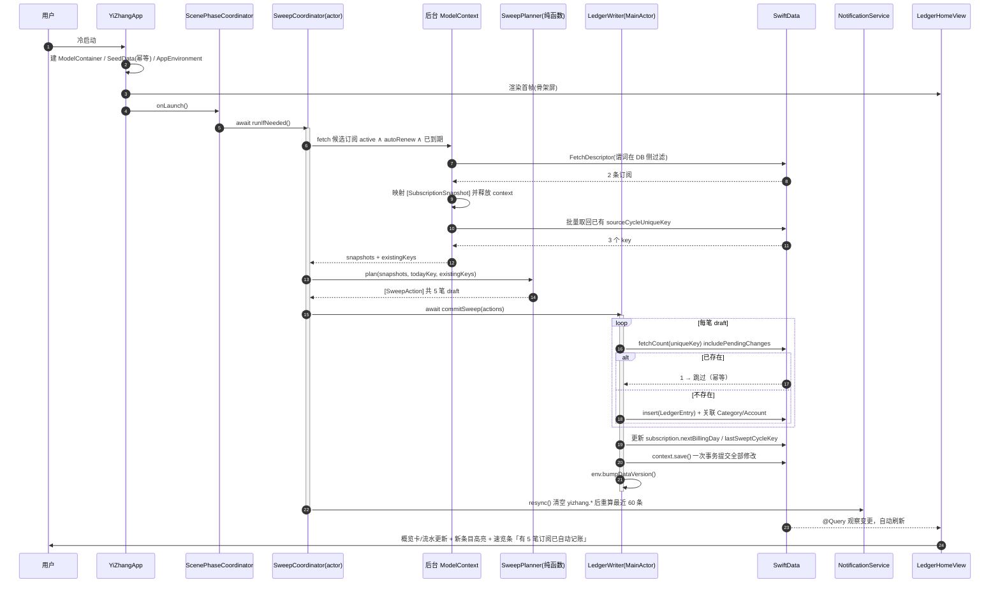
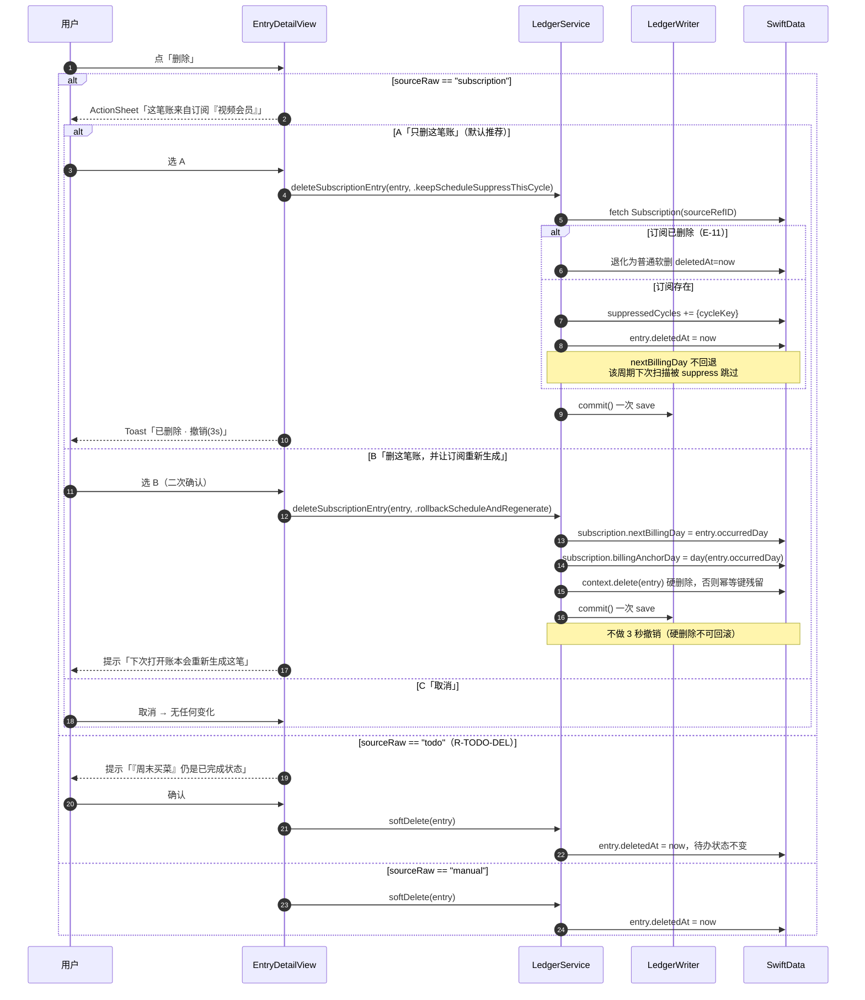
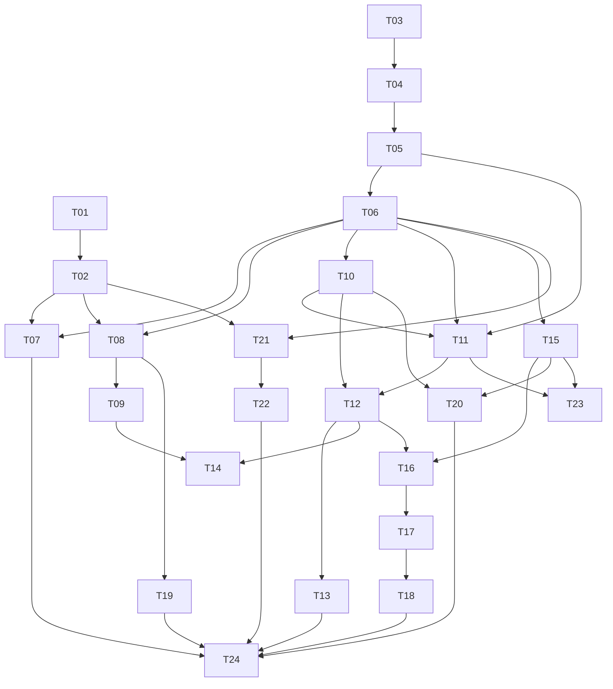

# 「一账」技术架构设计与任务分解

| 项目 | 内容 |
| --- | --- |
| 产品 | 一账（YiZhang）· iOS 17.0+ · iPhone 竖屏优先，iPad 兼容模式 |
| 技术栈 | Swift 5.10 / SwiftUI / SwiftData / Swift Charts / UserNotifications |
| 撰写 | 高见远（架构师）｜上游输入 `docs/01-PRD.md` v1.0 |
| 定位 | 承接 PRD 全部 R 编号规则，产出可直接开工的技术设计与 24 个任务的实现顺序 |

**四条贯穿全文的铁律**

| 编号 | 铁律 | 落地手段 |
| --- | --- | --- |
| A1 | 金额只有一种表示：`Int64` 分。任何环节不出现 `Double`/`Decimal` | `Money` 值类型作唯一入口 |
| A2 | "自然日"是一个整数，不是一个时刻 | 所有日历日语义存 `Int32 yyyyMMdd`，彻底绕开时区/DST |
| A3 | 账目只有一个写入者 | `LedgerWriter` 是唯一能 `insert(LedgerEntry)` 的地方 |
| A4 | 数据模型从第一天就是 CloudKit 形状 | 无 `unique`、无缺默认值、关系全可选、无 `.deny` |

---

## 1. 技术选型与理由

| 关注点 | 选型 | 理由 | 被否方案 |
| --- | --- | --- | --- |
| UI | **SwiftUI**（iOS 17） | `Observable` + `@Query` 是自动刷新链路的前提，省掉整套 `ObservableObject` 胶水 | UIKit：与 `@Query` 无法整合 |
| 持久化 | **SwiftData**（见 §1.2） | 见下 | Core Data / GRDB：见 §1.2 |
| 图表 | **Swift Charts** | 深色模式、Dynamic Type、`accessibilityLabel` 零成本满足 PRD §8 无障碍要求 | 自绘 Canvas：tooltip 与坐标轴全手写，收益为负 |
| 通知 | **UserNotifications 本地通知** | 无服务端（R-SUB-9 明确不做 BGTask） | BGTaskScheduler |
| 日期 | **Foundation `Calendar` 仅用于 DateOnly 边界换算** | 不让 `Calendar` 进入业务比较逻辑（A2） | SwiftDate 等三方库：无必要 |
| 测试 | **Swift Testing** 为主，**XCTest** 做内存库集成与 `measure` 性能基线 | 参数化测试写"20 条期末对齐用例"极省行 | 纯 XCTest：样板过多 |
| 三方依赖 | **零**（无例外） | 见 §1.3 | — |
| 最低系统 | **iOS 17.0** | 代价必须写清：**iOS 17 没有 `#Index` 与 `propertiesToFetch`（均 iOS 18 才有）**，应对见 §3.4 | 抬到 18 换索引：放弃约一年设备，不建议 |

### 1.2 持久化：为什么最终选 SwiftData

| 维度 | SwiftData | Core Data | GRDB |
| --- | --- | --- | --- |
| 复合唯一约束 | ❌ 不支持（`.unique` / `#Unique` 均仅单属性） | ✅ `uniquenessConstraints` | ✅ `UNIQUE INDEX` |
| CloudKit 兼容 | ✅ 一行配置 | ✅ 但**同样禁止 unique / 缺默认值 / `.deny`** | ❌ 需自研 CKSyncEngine |
| 批量聚合 | ⚠️ 无 GROUP BY | ⚠️ 有 `NSExpressionDescription` | ✅ 任意 SQL |
| SwiftUI 集成 | ✅ `@Query` | ❌ 仍需 `ObservableObject` | ❌ 手写全部 |
| 事务 | ⚠️ 靠"同一 context 多次改 + 一次 `save()`" | ⚠️ 同左 | ✅ `write {}` |
| 上架后开 iCloud | 一行 | 中 | 不可能（第 3 版重写） |

**核心判断：Core Data 在"复合唯一"上的优势是本项目的假优势。** PRD Q1 决定 V1.1 开 CloudKit 私有库，而 CloudKit 后端**禁止唯一约束**（启动即抛错）。为复合唯一去选 Core Data，到开同步那天仍要拆掉约束，还多付了整套 `NSManagedObject` 样板。**结论：复合唯一在这条产品路线上最终只能由业务层保证，数据库保证不了。** 既然必然如此，就没有理由倒戈。

GRDB 是唯一真能做库级唯一的方案，但它把 Q1 的承诺变成不可能（自研同步或第 3 版重写存储）。对个人开发者，这是最坏的一笔交易。

**结论：SwiftData。** 三处短板都有低成本对策：

| 短板 | 真实影响 | 对策 |
| --- | --- | --- |
| ① 无复合唯一 | 重复触发产生重复账目，违反 R-SUB-7 | 冗余键字段 + 单写 actor 内"先查后插" + 启动自检（§3.3） |
| ② 无 GROUP BY | 统计只能取回内存再算 | 用整数区间把 fetch 规模压到单月/单年（§5.6） |
| ③ CloudKit 限制 | 首版用错就要做非轻量迁移，有丢数据风险 | 首版即满足 7 条约束，V1.1 只改一个常量（§3.6） |

### 1.3 关于零第三方依赖

依赖清单是**空的**：图表→Swift Charts，金额格式化→`NumberFormatter` 封装，分享→`ShareLink`，计算器→自研 40 行 `CalculatorEngine`，测试→Swift Testing。若后续确需引入，唯一可接受类别是"纯算法、无网络、无隐私采集、SwiftPM 源码依赖"，且需你确认。

---

## 2. 工程结构（65 个源文件）

分层原则：**Core 不依赖 Features；Features 之间不互相 import（只经 Core/Services 通信）**。

```
YiZhang/
├── App/                                   # 装配层：只接线，无业务逻辑
│   ├── YiZhangApp.swift                     # @main；建 ModelContainer、注入 AppEnvironment            ~80
│   ├── AppEnvironment.swift               # 依赖容器 + dataVersion 变更广播                             ~120
│   ├── RootTabView.swift                  # 4 Tab + 各 Tab 独立 NavigationStack + 跨 Tab 跳转           ~160
│   └── ScenePhaseCoordinator.swift        # scenePhase 驱动扫描/通知重算/自检                          ~90
├── Core/
│   ├── Models/                            # @Model：纯数据 + 计算属性
│   │   ├── Enums.swift                    # 7 枚举 + raw 映射 + 文案                                    ~220
│   │   ├── Account.swift                  # 账户                                                      ~70
│   │   ├── Category.swift                 # 分类（type 与账目类型强绑）                                 ~70
│   │   ├── LedgerEntry.swift              # 账目（软删、来源徽章、来源回溯）                             ~140
│   │   ├── Subscription.swift             # 订阅（anchorDay、suppressedCycles、状态机）                ~160
│   │   ├── Todo.swift                     # 待办（hasExpense、repeatRule、linkedEntryID）              ~150
│   │   └── AppSettings.swift              # 单例设置                                                   ~90
│   ├── Domain/                            # 纯 Swift，**不 import SwiftData / SwiftUI**
│   │   ├── DateOnly.swift                 # Int32 yyyyMMdd：构造/加减/月周区间/格式化                   ~200
│   │   ├── Money.swift                    # Int64 分：解析/格式化/无障碍朗读                            ~160
│   │   ├── CycleAdvancer.swift            # 期末对齐推进（R-SUB-8），纯函数                              ~130
│   │   ├── SweepPlanner.swift             # 订阅快照+今天 → [SweepAction]，纯函数                        ~180
│   │   ├── MonthlyStatsCalculator.swift   # 月度汇总/占比/累计/6 月对比                                  ~220
│   │   ├── SubscriptionOverview.swift     # 每月固定支出折算/年度成本/30 天时间轴                        ~140
│   │   └── AccountBalanceCalculator.swift # R-ACC-1 余额只读计算                                        ~90
│   ├── Persistence/                       # 唯一能碰 ModelContext 的地方
│   │   ├── ModelContainerFactory.swift    # Schema/VersionedSchema/MigrationPlan/CloudKit 开关          ~120
│   │   ├── SeedData.swift                 # 首启种子（5 账户 + 19 分类 + AppSettings），幂等              ~200
│   │   ├── QueryDescriptors.swift         # FetchDescriptor 工厂（月份区间/来源/关键词/待扫描）           ~180
│   │   ├── LedgerWriter.swift             # **唯一写入口**：幂等插入/软删/撤销/事务/广播                 ~260
│   │   ├── SweepCoordinator.swift          # 扫描编排：计划→提交两阶段 + 去重 + 24 上限落地               ~150
│   │   └── Diagnostics.swift              # 启动自检：重复键/孤儿引用/非法日键/负金额                   ~140
│   ├── Services/                          # 用例层：一个用户动作 = 一个方法
│   │   ├── LedgerService.swift            # 手动/待办/订阅三类创建 + 编辑 + 软删 + 订阅删账双分支          ~220
│   │   ├── SubscriptionService.swift      # 订阅 CRUD + 状态机 + 补录 + 已续费                           ~260
│   │   ├── TodoService.swift              # 待办 CRUD + 完成/撤销 + 重复实例生成                          ~240
│   │   ├── StatisticsService.swift        # 区间 fetch + 按 dataVersion 缓存                             ~160
│   │   ├── NotificationService.swift      # 授权/注册/撤销/全量重算（前缀 + 60 条上限）                   ~230
│   │   └── ExportService.swift            # CSV/JSON → 临时文件 + 分享 URL                              ~170
│   └── DesignSystem/                      # 视觉令牌 + 复用组件，禁止业务判断
│       ├── Theme.swift                    # 颜色/字号/间距/12 色板/深色双套                              ~180
│       ├── MoneyText.swift                # 金额文本（等宽数字、正负色、朗读）                            ~110
│       ├── CommonViews.swift              # EmptyState/SectionCard/PrimaryButton/Chip/骨架屏             ~240
│       ├── CategoryGlyph.swift            # 分类图标圆底（深色对比度处理）                               ~90
│       ├── AmountKeypad.swift             # 自研金额键盘                                                 ~200
│       └── ToastHost.swift                # Toast + 3 秒撤销（R-EDIT-3 的 UI 载体）                       ~130
├── Features/
│   ├── Ledger/                            # 账本（首页）
│   │   ├── LedgerHomeView.swift           # 三段式首页 + FAB + 下拉刷新                                  ~260
│   │   ├── LedgerHomeViewModel.swift      # 月份上下文/分组/汇总/速览计数                                ~220
│   │   ├── HomeHeaderCards.swift          # 月度概览卡 + 今日速览条                                       ~200
│   │   ├── EntryRowView.swift             # 账目行（图标/两行文本/徽章/金额）                             ~120
│   │   ├── EntryDetailView.swift          # 详情 + 编辑入口 + 删除（含订阅双分支 Sheet）                  ~230
│   │   └── EntryFilterSheet.swift         # 六维筛选 + EntryFilterState                                  ~280
│   ├── Entry/
│   │   ├── EntryEditorView.swift          # 单屏录入（R-IN 全部规则）                                     ~300
│   │   ├── EntryEditorViewModel.swift     # 默认值记忆/类型切换/校验                                      ~230
│   │   ├── Pickers.swift                  # 分类宫格 + 账户 chip + 日期快捷                               ~240
│   │   └── CalculatorEngine.swift         # 四则运算求值（P1，纯函数）                                    ~120
│   ├── Todo/
│   │   ├── TodoListView.swift             # 分组列表 + 左滑 + 底部计数                                     ~250
│   │   ├── TodoListViewModel.swift        # 分组切分/逾期判定/订阅只读项注入                              ~200
│   │   ├── TodoRowView.swift              # 待办行                                                        ~140
│   │   ├── TodoEditorView.swift           # 编辑 Sheet + 详情态（撤销完成、已记账跳转）                    ~300
│   │   ├── TodoEditorViewModel.swift      # 花销开关/重复/提醒联动                                        ~210
│   │   ├── TodoCompletionSheet.swift      # 完成确认条 + VM（R-TODO-2）                                   ~230
│   │   └── SubscriptionDueSection.swift   # 订阅扣费只读折叠分组                                          ~130
│   ├── Subscription/
│   │   ├── SubscriptionListView.swift     # 总览卡 + 时间轴 + 三组列表 + 左滑                             ~250
│   │   ├── SubscriptionListViewModel.swift# 分组/排序/待续费/试用中/异常标记                               ~200
│   │   ├── SubscriptionOverviewCards.swift# 每月固定支出 + 年度成本 + 30 天时间轴                          ~220
│   │   ├── SubscriptionRowView.swift      # 订阅行                                                        ~130
│   │   └── SubscriptionEditorView.swift   # 编辑 Sheet + VM（五档周期/日期/试用/补录）                     ~360
│   ├── Statistics/
│   │   ├── StatisticsView.swift           # 骨架 + 分段 + 空态                                            ~180
│   │   ├── StatisticsViewModel.swift      # 三图取数 + 下钻                                               ~180
│   │   └── StatisticsCards.swift          # 环形/折线/双柱 + 分类排行（4 个私有 View）                     ~420
│   └── Settings/
│       ├── SettingsView.swift             # 分组列表 + 提醒开关 + 权限引导 + 关于                          ~230
│       ├── ManageViews.swift               # 账户管理/分类管理/两个编辑 Sheet                              ~420
│       └── ExportView.swift               # 导出页（CSV/JSON + 范围 + 分享）                              ~150
└── Resources/
    ├── Assets.xcassets                    # AppIcon / 色板 / 9 个空态插画
    └── PresetCatalog.swift                # 40 图标 + 12 色 + 19 分类 + 5 账户 + 空态文案                  ~260
```

**目录红线**

| 目录 | 允许 | 禁止 |
| --- | --- | --- |
| `Core/Models` | `SwiftData`、`Foundation` | 业务判断、`Calendar` 比较、金额转字符串 |
| `Core/Domain` | `Foundation` | `SwiftData`、`SwiftUI`、任何 IO |
| `Core/Services` | 上述 + `UserNotifications` | `SwiftUI` |
| `Features/*` | 全部 | 直接 `context.insert/delete`（必须走 `LedgerWriter`） |

读取侧允许 View 直接用 `@Query`（这是 SwiftUI+SwiftData 的核心红利，强包一层 Repository 只会白写 300 行），但 `FetchDescriptor` **必须来自 `QueryDescriptors`**，不允许 View 手搓谓词——保证"月份区间查询"这类高危逻辑只有一份实现。

---

## 3. 数据模型设计

### 3.1 账目（LedgerEntry）

```swift
@Model
final class LedgerEntry {
    // 标量：全部带默认值（CloudKit 强制）
    var id: UUID = UUID()
    var typeRaw: String = "expense"           // EntryType raw
    var amount: Int64 = 0                     // 分，> 0（A1）
    var occurredDay: Int32 = 0                // yyyyMMdd，权威字段（A2）
    var note: String = ""
    var tags: [String]? = nil                 // P1 预留，V1.0 不暴露 UI
    var sourceRaw: String = "manual"          // Source raw
    var sourceRefID: UUID? = nil              // 弱引用：源对象可删，账目保留（§6 铁律 3）
    var sourceCycleKey: String? = nil         // 订阅周期键（§3.3）
    var sourceCycleUniqueKey: String? = nil   // "\(sourceRefID)|\(cycleKey)"，幂等键
    var createdAt: Date = Date(timeIntervalSince1970: 0)
    var updatedAt: Date = Date(timeIntervalSince1970: 0)
    var deletedAt: Date? = nil                // 软删除（R-EDIT-3）

    // 关系：全部可选 + 显式反向（CloudKit 强制）
    var category: Category? = nil
    var account: Account? = nil
    var toAccount: Account? = nil             // 仅 transfer
}
```

| 子端 | 父端 | 删除规则 |
| --- | --- | --- |
| `LedgerEntry.category` | `Category.entries` | `.nullify` |
| `LedgerEntry.account` / `.toAccount` | `Account.entries` / `.incomingTransfers` | `.nullify` |
| `Todo.category` / `.account` / `.linkedEntry` | 对应父端 | `.nullify` |
| `Subscription.category` / `.account` | 对应父端 | `.nullify` |
| `Todo.sourceSubscription` | `Subscription.derivedTodos` | `.nullify` |

**不用 `.cascade`**：PRD §6 铁律 3「删除事 ≠ 删除账目」，任何级联都会违反。**不用 `.deny`**：CloudKit 不支持（A4）。删除联动一律由 Service 显式决定。

### 3.2 账户 / 分类 / 订阅 / 待办 / 设置

```swift
@Model final class Account {
    var id: UUID = UUID(); var name: String = ""
    var kindRaw: String = "cash"              // cash/debit/credit/alipay/wechat/other
    var initialBalance: Int64 = 0             // 分，仅展示（R-ACC-1）
    var isArchived: Bool = false
    var sortOrder: Int = 0
    var createdAt: Date = Date(timeIntervalSince1970: 0)
    var updatedAt: Date = Date(timeIntervalSince1970: 0)
    @Relationship(deleteRule: .nullify, inverse: \LedgerEntry.account)
    var entries: [LedgerEntry]? = []
    @Relationship(deleteRule: .nullify, inverse: \LedgerEntry.toAccount)
    var incomingTransfers: [LedgerEntry]? = []
    @Relationship(deleteRule: .nullify, inverse: \Subscription.account) var subscriptions: [Subscription]? = []
    @Relationship(deleteRule: .nullify, inverse: \Todo.account) var todos: [Todo]? = []
}

@Model final class Category {
    var id: UUID = UUID(); var name: String = ""
    var typeRaw: String = "expense"           // 与账目类型强绑（R-CAT）
    var iconName: String = "circle"; var colorHex: String = "#8E8E93"
    var isPreset: Bool = false; var isHidden: Bool = false; var sortOrder: Int = 0
    var createdAt: Date = Date(timeIntervalSince1970: 0)
    var updatedAt: Date = Date(timeIntervalSince1970: 0)
    @Relationship(deleteRule: .nullify, inverse: \LedgerEntry.category) var entries: [LedgerEntry]? = []
    @Relationship(deleteRule: .nullify, inverse: \Todo.category) var todos: [Todo]? = []
    @Relationship(deleteRule: .nullify, inverse: \Subscription.category) var subscriptions: [Subscription]? = []
}

@Model final class Subscription {
    var id: UUID = UUID(); var name: String = ""
    var amount: Int64 = 0                     // 分，允许 0（E-9）
    var currency: String = "CNY"
    var cycleUnitRaw: String = "month"        // day/week/month/quarter/year
    var cycleValue: Int = 1                   // 1…366
    var billingAnchorDay: Int = 1             // **期末对齐锚定日**（§5.2）
    var firstBillingDay: Int32 = 0            // 允许过去（E-5）
    var nextBillingDay: Int32 = 0             // **0 = 无（已取消，E-3）**
    var autoRenew: Bool = true
    var trialEndDay: Int32 = 0                // 0 = 无试用
    var note: String = ""; var iconName: String = ""; var colorHex: String = ""
    var statusRaw: String = "active"          // active/paused/cancelled
    var reminderDays: Int = 1                 // 0/1/3/7
    var suppressedCycles: [String]? = []       // R-SUB-DEL A
    var lastSweptCycleKey: String? = nil
    var createdAt: Date = Date(timeIntervalSince1970: 0)
    var updatedAt: Date = Date(timeIntervalSince1970: 0)
    var category: Category? = nil
    var account: Account? = nil
    @Relationship(deleteRule: .nullify, inverse: \Todo.sourceSubscription) var derivedTodos: [Todo]? = []
}

@Model final class Todo {
    var id: UUID = UUID(); var title: String = ""; var note: String = ""
    var dueDay: Int32 = 0                     // 0 = 无日期
    var dueTimeMinutes: Int32 = -1            // 当日分钟数，-1 = 无具体时间
    var hasExpense: Bool = false
    var estimatedAmount: Int64 = 0            // 分
    var hasEstimatedAmount: Bool = false      // 区分"未填"与"填了 0"
    var priorityRaw: String = "none"
    var repeatRuleRaw: String = "none"        // none/daily/weekly/monthly/yearly
    var repeatInterval: Int = 1
    var statusRaw: String = "open"            // open/done
    var completedAt: Date? = nil
    var reminderDay: Int32 = 0
    var reminderMinutes: Int32 = -1
    var linkedEntryID: UUID? = nil            // 回写（R-TODO-3）
    var createdAt: Date = Date(timeIntervalSince1970: 0)
    var updatedAt: Date = Date(timeIntervalSince1970: 0)
    var category: Category? = nil
    var account: Account? = nil
    var sourceSubscription: Subscription? = nil
    var linkedEntry: LedgerEntry? = nil
}

@Model final class AppSettings {
    var id: UUID = UUID()
    var defaultAccountID: UUID? = nil         // 上次使用账户（F-ACC-07）
    var recentCategoryIDs: [UUID]? = nil      // 最近使用 6 个（有序）
    var currentMonthKey: Int32 = 0
    var subscriptionReminderEnabled: Bool = true
    var todoReminderEnabled: Bool = true
    var appearanceRaw: String = "system"
    var hasSeeded: Bool = false
    var lastSweptAt: Date? = nil
}
```

**枚举一律存 `xxxRaw: String` + 计算属性**。三条理由：①iOS 17 上 `#Predicate` 对 `RawRepresentable` 枚举支持不稳定（`type == .expense` 常编译失败），`typeRaw == "expense"` 永远可靠；②CloudKit 同步时自定义 `Codable` 可能退化为不透明二进制块，标量 `String` 不会；③导出零转换。

### 3.3 复合唯一 (sourceRefID, sourceCycleKey) 的实现方案

SwiftData 的 `.unique` 与 `#Unique` 都只支持单属性；CloudKit 完全禁止唯一约束。方案三层，**任一层单独失效都不会产生重复账目**：

**第 1 层｜冗余幂等键字段**

| 来源 | sourceCycleKey | sourceCycleUniqueKey |
| --- | --- | --- |
| manual | nil | nil |
| todo | nil | `todo\|<todoID>` |
| subscription（month/quarter/year） | `2025-11` | `<subID>\|2025-11` |
| subscription（day/week） | `d-20251101` | `<subID>\|d-20251101` |

生成规则的唯一实现位置是 `LedgerService.makeUniqueKey(...)`。

**第 2 层｜单写入口 + 先查后插**

```swift
if let key = draft.uniqueKey {
    var d = FetchDescriptor<LedgerEntry>(predicate: #Predicate { $0.sourceCycleUniqueKey == key })
    d.fetchLimit = 1
    d.includePendingChanges = true     // 关键：本 context 未提交的插入也算
    if try context.fetchCount(d) > 0 { return .skippedDuplicate }
}
```

`includePendingChanges` 让"同一批次里连续两次生成同一周期"也能被挡住。

**第 3 层｜启动自检修复**：`Diagnostics.run` 按 `sourceCycleUniqueKey` 分组，>1 条时保留 `createdAt` 最早者，其余写 `deletedAt`（DEBUG 自动修，Release 只记录）。

**为什么不用 `@Attribute(.unique)`（即使单字段能用）**

1. CloudKit 迁移时必须在 V2 摘掉它，而**摘除唯一约束不是轻量迁移**，SwiftData 可能走重建路径——V1.0 已有用户数据时这是不可接受的风险窗口。
2. SwiftData 的 `.unique` 语义是 **upsert（冲突时覆盖）**，而 R-SUB-7 要的是"跳过且不污染"。要拿到跳过语义，代码里那次 `fetchCount` 无论如何都得写；既然要写，DB 约束就是纯冗余，而且还会静默改写历史账目。

**结论**：`sourceCycleUniqueKey` 只是普通 `String?`，**幂等由"单写 actor + 先查后插"保证**——这是唯一在 V1.1 开 CloudKit 后不需要任何迁移的解法。

### 3.4 索引设计（含 iOS 17 的真实限制）

**`#Index` 宏是 iOS 18 引入的，iOS 17 不可用**，所以 V1.0 无法声明任何自定义索引：

| 需要的索引 | 应对 |
| --- | --- |
| `occurredDay`（范围查询主力） | ≤1 万行全表扫 1–3ms；强约束"所有查询用整数区间谓词 + `fetchLimit` + 分页" |
| `nextBillingDay`（扫描候选） | 谓词另加 `statusRaw=="active"`，候选 ≤3 条，代价可忽略 |
| `sourceCycleUniqueKey`（幂等查询） | 每次扫描 ≤24 次单键查询，合计 <50ms |

索引声明以注释预留在 `ModelContainerFactory`，抬到 iOS 18 只需取消注释，业务零改动：

```swift
// #Index<LedgerEntry>([\.occurredDay], [\.sourceCycleUniqueKey])
// #Index<Subscription>([\.nextBillingDay], [\.statusRaw])
```

### 3.5 Money 与 DateOnly（本项目最易错的地方）

```swift
struct Money: Hashable, Comparable, Codable, Sendable {
    let cents: Int64
    static func parse(_ raw: String) -> Money?        // "12.5" → 1250，全程字符串，不经 Double
    func formatted(style: Style) -> String            // 1250 → "¥12.50"，缓存 NumberFormatter
    var accessibilityText: String
}

struct DateOnly: Hashable, Comparable, Codable, Sendable {
    let key: Int32                                    // yyyyMMdd
    init(_ date: Date, calendar: Calendar = .current)  // 唯一"时刻→日"换算点
    var date: Date { get }                            // 仅供 DatePicker 绑定与展示
    var year: Int { Int(key / 10_000) }; var month: Int { Int(key / 100) % 100 }; var day: Int { Int(key % 100) }
    var monthKey: Int32 { year * 100 + month }
    func adding(days: Int) -> DateOnly
    static func monthRange(_ monthKey: Int32) -> ClosedRange<Int32>
    static func weekRange(containing: DateOnly) -> ClosedRange<Int32>   // 周一…周日
}
```

**为什么模型只存 `Int32` 而不存 `Date`**

| 方案 | 时区变化后漂移 | `#Predicate` 可用性 | 结论 |
| --- | --- | --- | --- |
| `Date` + `startOfDay` | **会漂**。北京 11/20 存为 `11-19T16:00Z`，到洛杉矶解析回 11/19，账目自己跑一天 | 好 | ❌ 财务数据不可接受 |
| `Date` 存 UTC 正午 | ±12h 内安全，UTC+13/+14 仍漂 | 好 | ⚠️ 靠约定维持，脆 |
| **`Int32 yyyyMMdd`** | **永不漂**（整数无时区） | ✅ 整数比较，且绕开 iOS 17 对 `Optional<Date>` 谓词的不稳定支持 | ✅ **采用** |

两项额外收益其实比"防漂移"更立竿见影：

1. **`#Predicate` 里不能调用 `Calendar`。** 筛"本月"时用整数只需 `$0.occurredDay >= 20251101 && $0.occurredDay <= 20251130`，永不出错；用 `Date` 闭区间遇上 DST 有 off-by-one 风险。
2. **iOS 17 上 `Optional` 谓词容易崩。** 所以所有"日"字段统一用 **`0` 作哨兵**（`nextBillingDay = 0` 表示无、`trialEndDay = 0` 表示无、`dueDay = 0` 表示无日期）。模型里没有一个 `Int32?`，谓词全是纯整数比较，消除一大类崩溃与查询静默失败。

**全项目 `Calendar` 只出现 4 处**：`DateOnly.init(Date)`、`DateOnly.date`、`weekRange`、`monthRange`。除此之外任何人写 `Calendar` 都是 code review 的 reject 项。

### 3.6 CloudKit 兼容：如何从第一天满足（A4）

| CloudKit 约束 | 本设计如何满足 |
| --- | --- |
| 属性必须 optional 或**有默认值** | 每个标量都有字面量默认值；`Date` 默认 `Date(timeIntervalSince1970: 0)` 而非 `.now`（迁移确定性） |
| 关系必须可选 | 全部 `Model? = nil` / `[Model]? = []` |
| 必须提供反向关系 | 每个 to-many 侧显式 `inverse:`（见 §3.1/3.2 代码） |
| 禁止唯一约束 | 不用 `.unique` → grep 命中数应为 0 |
| 禁止 `.deny` | 全表只用 `.nullify` → grep 命中数应为 0 |
| 数组属性 | `suppressedCycles` / `recentCategoryIDs` / `tags` 均为可选数组（降级预案见风险 R2） |
| 容器配置 | 一个 `bool` 开关：V1.0 `.none`，V1.1 `.automatic` |

```swift
enum ModelContainerFactory {
    static let cloudKitEnabled = false        // V1.1 改为 true，schema 不变
    static func make(inMemory: Bool = false) throws -> ModelContainer {
        let schema = Schema(versionedSchema: SchemaV1.self)
        let config = ModelConfiguration(schema: schema, isStoredInMemoryOnly: inMemory,
                                        cloudKitDatabase: cloudKitEnabled ? .automatic : .none)
        return try ModelContainer(for: schema, configurations: [config])
    }
}
```

`SchemaV1` 用 `VersionedSchema` 显式声明，`SchemaMigrationPlan` 已建壳。V1.1 开同步时**不需要新增 stage**，因为 schema 一个字节都没变——这就是 A4 的兑现方式。

### 3.7 偏离清单（我改了 PRD 的地方，请确认）

| # | PRD 原文 | 本设计 | 为什么必须改 |
| --- | --- | --- | --- |
| **D1** | `occurredAt: Date` / `dueDate: Date` / `nextBillingDate: Date` | `occurredDay` / `dueDay` / `nextBillingDay`：`Int32` yyyyMMdd，另提供计算属性 `xxxAt: Date` 供 UI | §3.5：`Date` 会时区漂移；iOS 17 谓词对 `Optional<Date>` 不稳；`#Predicate` 内不能调 `Calendar` |
| **D2** | `sourceCycleKey` 固定 `yyyy-MM`（R-SUB-4） | month/quarter/year → `yyyy-MM`；**day/week → `d-yyyyMMdd`** | **PRD 的真实漏洞**：E-7 支持"每 45 天""每两周"，这两类一个月可能扣两次，用 `yyyy-MM` 会**幂等键碰撞 → 第二次扣费被静默丢弃 → 漏账** |
| **D3** | `nextBillingDate` 可空（E-3「置空」） | 用 `0` 哨兵 | 整数谓词稳定；`0` 天然排在所有真实日期之前，语义自洽 |
| **D4** | `Todo.isSystemGenerated` / `sourceSubscriptionID` 落库（5.1） | **不落库**。待办页顶部订阅只读项由 `SubscriptionOverview.upcoming(within: 30)` 实时派生为 `DueItemViewData` | 落库会造出与 Subscription 重复的真相源：改期要同步改 30 条假待办、删订阅要级联清理；且 R-MIX-4 明确这些项"不生成第二笔账""不进计数"，没有任何需要持久化的状态。`Todo.sourceSubscription` 保留为 V1.1 预留 |
| **D5** | `suppressedCycles: [String]?` | 保留；若 V1.1 发现 CloudKit 数组兼容问题，降级为 `suppressedCyclesCSV: String` | 见风险 R2 |
| **D6** | `Category.type` / `Account.kind` 为枚举 | 存 `rawValue: String` | iOS 17 谓词对枚举不稳；CloudKit 对标量最友好；导出零转换 |

D1/D3/D6 是纯存储表示改动，**对 UI 与产品行为零影响**；**D2 是修正真实缺陷**；D4 是删掉一个不必要的持久化字段。**请重点确认 D2。**

---

## 4. 分层与职责边界

| 层 | 代表 | 职责 | 硬性禁止 |
| --- | --- | --- | --- |
| **View** | `LedgerHomeView` | 声明式布局、动画、无障碍标签、把意图翻译成 VM 方法调用 | 禁止 `context.insert/delete`；禁止业务判断（如"金额>0 才能存"） |
| **ViewModel**（`@Observable`） | `LedgerHomeViewModel` | 持有视图状态（月份/筛选/弹层）、调 Service、整理展示模型 | 禁止直接写 `ModelContext`；禁止格式化金额（走 `MoneyText`） |
| **Service** | `LedgerService` | 一个方法 = 一个用户用例；跨 Model/Domain 编排；决定写什么、什么顺序、是否事务 | 禁止 `import SwiftUI`；禁止自己 `save()`（必须经 `LedgerWriter`） |
| **Writer / Repo** | `LedgerWriter` | 唯一碰 `ModelContext`；幂等、软删、事务提交、变更广播 | 禁止包含业务规则；禁止被 View 直接持有 |

数据流单向：`View → ViewModel → Service → LedgerWriter/QueryDescriptors → SwiftData`。

### 4.2 Domain 是否 import SwiftData？——不 import，但也不过度抽象

两种做法：**A（严格）** Domain 定义 `protocol LedgerEntryProtocol` 让 `@Model` 遵守；**B（务实）** Domain 定义轻量 DTO，Service 负责一次拷贝。

**本项目选 B。** 理由：

1. 做法 A 要给每个 `@Model` 补十几个 protocol 遵循声明，而 protocol 无法表达关系遍历，实践中很快退化为 `AnyObject` + 强转，收益归零。
2. 做法 B 有额外硬收益：`MonthlyStatsCalculator` 需要一年数据，传 `@Model` 数组会把整行（含 note/tags/关系）全部 materialize；传 `LedgerLite`（4 个标量）内存友好，且**单元测试不需要 `ModelContainer`**——纯 struct 数组即跑，测试速度提升一个量级。
3. `SweepPlanner` 同理：输入 `SubscriptionSnapshot`（14 个标量）→ 输出 `[SweepAction]`。**R-SUB-3/4/5/8 的全部规则因此可以在 0 个数据库的情况下被完整单测**，这是本设计价值最高的一处边界。

```swift
struct LedgerLite: Sendable {
    let id: UUID; let amount: Int64; let typeRaw: String
    let occurredDay: Int32; let categoryID: UUID?; let accountID: UUID?
    let sourceRaw: String; let deletedAt: Date?
}
struct SubscriptionSnapshot: Sendable {
    let id: UUID; let name: String; let amount: Int64
    let statusRaw: String; let autoRenew: Bool
    let nextBillingDay: Int32; let trialEndDay: Int32
    let cycleUnit: CycleUnit; let cycleValue: Int; let anchorDay: Int
    let suppressedCycles: Set<String>; let categoryID: UUID?; let accountID: UUID?
}
```

### 4.3 依赖注入

```swift
@Observable final class AppEnvironment {
    let container: ModelContainer
    let ledger: LedgerService; let subscription: SubscriptionService; let todo: TodoService
    let stats: StatisticsService; let notifications: NotificationService
    let exporter: ExportService; let sweep: SweepCoordinator
    private(set) var dataVersion: Int = 0          // 任何写入提交后自增，用于缓存失效
    func bumpDataVersion() { dataVersion &+= 1 }
}
```

在 `YiZhangApp` 建一次，`.environment(env)` 注入整棵树。ViewModel 用 `@Environment(AppEnvironment.self)` 取依赖，**不用单例、不用 `EnvironmentObject` 链**——这样每个 VM 都能在测试里用 in-memory container 组装真依赖，无需 mock 框架。不用逐个 `EnvironmentKey` 是因为 7 个 Service 会有 7 份样板且新增要改 3 处。

---

## 5. 核心机制设计

### 5.1 BillingSweep 结算扫描（R-SUB-1…R-SUB-10）

**触发点**

| 触发点 | 位置 | 备注 |
| --- | --- | --- |
| 冷启动 | `YiZhangApp.task` → `ScenePhaseCoordinator.onLaunch()` | 与首帧并发，不阻塞 |
| `scenePhase → .active` | `ScenePhaseCoordinator` | **必须防抖**：一次前台常触发 2 次（启动 + 真 active），3 秒窗口合并 |
| 进入账本 / 订阅 Tab | 各 `View.task`，`guard 距上次 > 60s` | R-SUB-2 |
| 账本下拉刷新 | `.refreshable` | 用户显式意图，**不受节流** |
| 订阅编辑保存后 | `SubscriptionService.update` 末尾 | 让"改到过去"（E-10）立刻补生成 |

**并发与去重**：`SweepCoordinator` 是 `actor`，唯一 `isRunning` 标志：

```swift
func runIfNeeded(force: Bool = false) async {
    guard !isRunning else { return }                                   // ① 重入保护
    if !force, Date().timeIntervalSince(lastRunAt) < 60 { return }      // ② 节流
    isRunning = true; defer { isRunning = false; lastRunAt = Date() }
}
```

actor 串行保证"检查 flag → 置 flag"原子（①），保证同名触发点不并发跑两次；② 保证 Tab 切换抖动不引发重复扫描。

**两阶段：计划（后台读）→ 提交（主线程写）**

```
阶段 1（actor，独立 ModelContext，只读）
    fetch 候选订阅 → 映射 [SubscriptionSnapshot] → 一次批量取回已有幂等键 → 释放 context
阶段 2（纯函数，0 IO）  SweepPlanner.plan(...) -> [SweepAction]
阶段 3（MainActor，LedgerWriter，唯一写入点）
    逐条再查幂等键 → insert + 更新订阅日期 → 单次 context.save()（一个 SQLite 事务）→ bumpDataVersion()
```

**为什么不直接在后台 context 里写完再 merge**：iOS 17 上后台 context 保存后主 context 的 `@Query` 不保证立刻刷新（最常被踩的坑，风险 R6）。"读在后台、写在 MainActor"彻底绕开，写入路径从不跨 context。

**完整算法伪代码**

```swift
// SweepPlanner.plan（纯函数，可 100% 单测）
static func plan(snapshots: [SubscriptionSnapshot], todayKey: Int32,
                 existingUniqueKeys: Set<String>) -> [SweepAction] {
    var actions: [SweepAction] = []
    for sub in snapshots {
        // R-SUB-3 全部条件，最便宜的先判
        guard sub.statusRaw == "active", sub.autoRenew else { continue }   // R-SUB-6 交由通知
        guard sub.nextBillingDay > 0, sub.nextBillingDay <= todayKey else { continue }
        guard sub.amount > 0 else { continue }                            // E-9
        if sub.trialEndDay > 0, todayKey < sub.trialEndDay { continue }    // E-1

        var cursor = DateOnly(key: sub.nextBillingDay)
        var drafts: [EntryDraft] = []
        var generated = 0, capped = false

        while cursor.key <= todayKey {                                     // R-SUB-5 补漏循环
            if generated >= 24 { capped = true; break }                    // 单次上限
            let cycleKey  = sub.cycleKey(for: cursor)                      // §3.7 D2 规则
            let uniqueKey = "\(sub.id.uuidString)|\(cycleKey)"
            let exists     = existingUniqueKeys.contains(uniqueKey)         // R-SUB-7
            let suppressed = sub.suppressedCycles.contains(cycleKey)        // R-SUB-DEL A

            if !exists && !suppressed {
                drafts.append(EntryDraft(
                    typeRaw: "expense", amount: sub.amount,
                    occurredDay: cursor.key,                               // R-SUB-4① 用应扣日
                    categoryID: sub.categoryID, accountID: sub.accountID,
                    note: "订阅：\(sub.name)", sourceRaw: "subscription",
                    sourceRefID: sub.id, sourceCycleKey: cycleKey, uniqueKey: uniqueKey))
                generated += 1
            }
            // ★ 即使该周期被 suppress 或已存在，cursor 也必须推进，否则死循环
            cursor = CycleAdvancer.advance(from: cursor, anchorDay: sub.anchorDay,
                                           unit: sub.cycleUnit, value: sub.cycleValue)
        }
        actions.append(SweepAction(subscriptionID: sub.id, drafts: drafts,
            newNextBillingDay: cursor.key,                                 // R-SUB-4② 从原值推进
            newLastSweptCycleKey: drafts.last?.sourceCycleKey, cappedAt24: capped))
    }
    return actions
}
```

`cappedAt24 == true` 时**不新增 schema 字段**，而由 `Diagnostics` 实时计算 `anomalySubscriptionIDs`，订阅详情渲染时打标「订阅周期异常，请检查下次扣费日」。

**失败与部分成功**

| 情况 | 处理 |
| --- | --- |
| 阶段 1 读失败 | 整个扫描放弃，`lastRunAt` **不更新**，下次自然重试；不影响 UI |
| 阶段 3 某条插入抛错 | `save()` 整批提交，任一错误整批回滚 → **按订阅拆批重试一次**（逐条 `save()`），保证一条坏数据不拖垮其余；失败订阅记入内存集合，UI 给重试入口 |
| App 在阶段 3 前被杀 | **完全没写入**，日期未推进，下次冷启动重新补漏——天然幂等，无中间态 |
| 24 笔上限命中 | 停该订阅，其余照常，UI 打标 |

**事务边界结论**：一次 `save()` = 一个 SQLite 事务。阶段 3 把"账目插入 + 订阅日期推进"放在同一个 `save()` 里，满足 PRD §8「跨对象写入必须同一事务」。若拆批重试，**每一批内部仍是一个事务**（该订阅的账 + 自己的日期推进同生共死），语义正确。

**性能估算（1000 账目 + 50 订阅，iPhone 12 量级）**

| 步骤 | 规模 | 耗时 |
| --- | --- | --- |
| fetch 候选订阅（谓词在 DB 侧过滤） | ≤50，通常 0–3 | 1–3 ms |
| 批量取回已有幂等键 | ≤1200 行 | 3–8 ms |
| `SweepPlanner.plan` | 内存纯计算 | <1 ms |
| 阶段 3：≤24 次单键 `fetchCount` + 插入 + save | ≤24 行写 | 10–25 ms |
| **合计** | — | **15–40 ms，且只在后台 actor** |

优化手段按收益排序：①**只 fetch 活跃到期订阅**（把候选从 50 降到通常 0–3 条，绝大多数扫描的开销就是"fetch 了 0 条"，<5ms）；②幂等键一次批量取回，把 N 次查询变 1 次；③iOS 17 无 `propertiesToFetch`，故 fetch 后立即映射成 `SubscriptionSnapshot` 并释放 context，避免关系懒加载；④60s 节流。

### 5.2 周期推进算法（R-SUB-8 期末对齐）

**核心：推进时永不以"被夹紧后的日期"为基准，而以 `billingAnchorDay`（锚定日）为基准。**

```swift
enum CycleAdvancer {
    static func advance(from: DateOnly, anchorDay: Int, unit: CycleUnit, value: Int) -> DateOnly {
        switch unit {
        case .day:   return from.adding(days: value)
        case .week:  return from.adding(days: 7 * value)
        case .month, .quarter, .year:
            let months = value * unit.monthsMultiplier          // month=1, quarter=3, year=12
            var year  = from.year
            var month = from.month + months                     // value ≥ 1，不会出现负数
            year  += (month - 1) / 12
            month  = (month - 1) % 12 + 1
            let lastDay = daysInMonth(year: year, month: month)  // 固定表 + 闰年判定
            return DateOnly(year: year, month: month, day: min(anchorDay, lastDay))
        }
    }
}
```

`daysInMonth` 用固定表 + `year % 4 == 0 && (year % 100 != 0 || year % 400 == 0)`，**不依赖 `Calendar`**，因此任何时区/locale 下结果一致、可 100% 单测。

**锚定日何时重置**

| 事件 | `billingAnchorDay` |
| --- | --- |
| 新建订阅 | `= firstBillingDay.day` |
| 用户手改 `nextBillingDay`（E-10） | `= 新值.day`（"以此为准"） |
| 改周期（unit/value） | **不变**（"每月 31 号扣"这个事实没变） |
| 结算推进 | **不变**（防漂移的关键） |

**防漂移验证**（锚定 31，自 1/31 起）：`1/31 →(+1M) 2/28 →(+1M, min(31,31)) 3/31 →(+1M) 4/30 →(+1M) 5/31`。关键点：从 2/28 推进时用 `min(anchorDay=31, 3月天数=31)=31`，而**不是** `28+1月=3/28`。

**单元测试用例（20 条，`CycleAdvancerTests`，纯函数无 IO）**

| # | 起始（anchor） | 周期 | 期望 | 覆盖点 |
| --- | --- | --- | --- | --- |
| 1 | 2025-01-31 (31) | month×1 | 2025-02-28 | 月末夹紧（平年） |
| 2 | 2024-01-31 (31) | month×1 | 2024-02-29 | 闰年 |
| 3 | 2024-02-29 (29) | month×1 | 2024-03-29 | 闰日不漂 |
| 4 | 2025-02-28 (31) | month×1 | **2025-03-31** | **下下次仍从基准推算** |
| 5 | 02-28→03-31→04-30 (31) | month×1 | 2025-05-31 | 连续 4 次不漂移 |
| 6 | 2025-01-30 (30) | month×1 | 2025-02-28 | 锚定 30 遇 2 月 |
| 7 | 2025-03-31 (31) | month×1 | 2025-04-30 | 30 天月夹紧 |
| 8 | 2025-01-31 (31) | month×2 | 2025-03-31 | 每 2 个月 |
| 9 | 2025-03-31 (31) | month×2 | 2025-05-31 | 每 2 个月连续 |
| 10 | 2025-05-31 (31) | month×2 | 2025-07-31 | 跳过 6 月（30 天）不影响 |
| 11 | 2025-01-31 (31) | quarter×1 | 2025-04-30 | 季度 + 夹紧 |
| 12 | 2025-11-30 (30) | quarter×1 | 2026-02-28 | 季度跨年 + 2 月 |
| 13 | 2025-02-28 (28) | year×1 | 2026-02-28 | 年付 |
| 14 | 2024-02-29 (29) | year×1 | 2025-02-28 | 闰日年付夹紧 |
| 15 | 2025-02-28 (29) | year×1 | 2026-02-28 | 闰日不复活（预期损失，见 R4） |
| 16 | 2025-01-31 | day×45 | 2025-03-17 | 每 45 天，跨月不夹紧 |
| 17 | 2025-01-01 | week×2 | 2025-01-15 | 每两周 |
| 18 | 2025-12-15 | month×1 | 2026-01-15 | 跨年 |
| 19 | 2025-12-31 (31) | month×1 | 2026-01-31 | 跨年 + 锚定 31 |
| 20 | 2025-01-31 (1) | month×1 | 2025-02-01 | 手改后锚定日重置生效 |

用例 15 是唯一"有损"场景（闰日年付无法复位），UI 不承诺此行为，已记入风险 R4。

### 5.3 LedgerService：统一记账入口

```swift
@MainActor final class LedgerService {
    @discardableResult func create(_ draft: EntryDraft) throws -> CreateResult
    @discardableResult func createManual(_ input: ManualEntryInput) throws -> LedgerEntry
    func update(_ entry: LedgerEntry, with input: EntryEditInput) throws      // R-EDIT-1：不改 source
    func softDelete(_ entry: LedgerEntry) throws -> UndoToken                // R-EDIT-3
    func restore(_ token: UndoToken) throws
    func deleteSubscriptionEntry(_ entry: LedgerEntry, mode: SubscriptionDeleteMode) throws
}
enum SubscriptionDeleteMode { case keepScheduleSuppressThisCycle, rollbackScheduleAndRegenerate }
enum CreateResult { case created(LedgerEntry); case skippedDuplicate }
```

**A3 的落地方式是编译期保证**：`LedgerEntry.init` 声明 `fileprivate`（仅 `Models` 内可用），`LedgerWriter.insert` 是唯一调用点。三个 View 层在语法上就无法 new 一个 `LedgerEntry`。

**事务：生成账目 + 推进订阅日期必须原子**

SwiftData 无显式 `begin/commit`，语义是"同一 context 的所有修改暂存 pending changes，`save()` 时一次性 flush 到一个 SQLite 事务"。所以"原子"的落地方式就是**把两处修改放在同一个 `save()` 之前**：

```swift
func commitSweep(_ action: SweepAction, subscription: Subscription?) throws {
    for draft in action.drafts {
        if try isDuplicate(draft.uniqueKey) { continue }
        let entry = LedgerEntry(draft: draft)          // fileprivate init
        context.insert(entry)
        entry.category = try category(for: draft.categoryID)
        entry.account  = try account(for: draft.accountID)
    }
    subscription?.nextBillingDay = action.newNextBillingDay     // ← 同一个 context
    subscription?.lastSweptCycleKey = action.newLastSweptCycleKey
    try context.save()                                          // ← 唯一一次 save，原子
    env.bumpDataVersion()
}
```

**反例（禁止）**：先生成账目 `save()` 一次，再推进日期 `save()` 一次。中间崩溃会留下"有账但日期没推进"，下次扫描又被幂等键挡住、`nextBillingDay` 永远原地，最终撞到 24 笔上限。

**软删除与撤销**

```swift
func softDelete(_ entry: LedgerEntry) throws -> UndoToken {
    entry.deletedAt = .now; entry.updatedAt = .now
    try writer.commit()
    return UndoToken(entryID: entry.id, deletedAt: entry.deletedAt!)
}
func restore(_ token: UndoToken) throws {
    guard let e = try fetchEntry(token.entryID), e.deletedAt == token.deletedAt else { return }
    e.deletedAt = nil; try writer.commit()
}
```

- **软删只改 `deletedAt`**，R-EDIT-3「撤销即恢复（含 sourceCycleKey 等所有字段）」因此自动成立。
- 3 秒计时由 `ToastHost` 持有，**不落库**。App 在 3 秒内被杀 → 撤销入口消失但账目仍在（V1.1「最近删除」可找回）。这个取舍避免了"未决撤销状态"持久化的复杂度。
- **所有查询必须带 `deletedAt == nil`**，由 `QueryDescriptors` 每个工厂方法默认拼上，手写谓词被禁止。

**订阅账目删除的双分支（R-SUB-DEL）**

```swift
func deleteSubscriptionEntry(_ entry: LedgerEntry, mode: SubscriptionDeleteMode) throws {
    guard entry.sourceRaw == "subscription", let subID = entry.sourceRefID,
          let cycleKey = entry.sourceCycleKey, let sub = try fetchSubscription(subID) else {
        _ = try softDelete(entry); return                 // E-11 源订阅已删，退化为普通软删
    }
    switch mode {
    case .keepScheduleSuppressThisCycle:                  // A 分支（默认）
        var cycles = Set(sub.suppressedCycles ?? []); cycles.insert(cycleKey)
        sub.suppressedCycles = Array(cycles)              // 该周期不再生成
        entry.deletedAt = .now                            // nextBillingDay 不回退
    case .rollbackScheduleAndRegenerate:                  // B 分支
        sub.nextBillingDay = entry.occurredDay            // 回退到本周期起点
        sub.billingAnchorDay = DateOnly(key: entry.occurredDay).day   // 锚定日跟着重置
        context.delete(entry)                             // ★ 硬删除，不用软删
    }
    try writer.commit()
}
```

**B 分支必须硬删除，这是非直觉但关键的决策**：R-SUB-7 要求幂等键"含软删除记录"唯一。若 B 分支软删，`sourceCycleUniqueKey` 仍占用该键，下次扫描的幂等检查会命中 → **账目永远不会重新生成**，分支 B 变成"账永远消失"。因此 B 分支只在用户**明确要求重新生成**时硬删除，并配二次确认、不提供撤销；A 分支（默认路径）仍是软删除 + 可撤销。见风险 R8 + T14 验收。

### 5.4 待办完成的记账确认流程（R-TODO-1…8）

**状态机与拦截点**

```
              tapCheckbox（唯一拦截点）
   open ─────────────────────────────────► 待确认（纯 UI 瞬态，不持久化）
     ▲                                            │
     │                          hasExpense=false ──┴── hasExpense=true
     │                                 │                    │
     │                                 ▼              确认条弹出
     │                          done（零打扰，R-TODO-5）  ┌──┴──┐
     │                                                   ▼     ▼
     │                                            完成并记账   不记账
     │                                        （done+账目+   （done，
     │                                          linkedID）   linkedID=nil）
     └──── 撤销完成 done→open（R-TODO-7 询问是否删账目）◄────────┘
```

**`待确认` 不是持久化状态**，`Todo.statusRaw` 只有 `open`/`done`。理由：若把 `pending_confirmation` 写库，App 在确认条弹出时被杀会留下"永远等确认"的僵尸待办，需要额外启动修复；纯 UI 瞬态最坏只是"勾选没生效"（用户再点一次）。

**确认弹层 VM**

```swift
@Observable @MainActor final class TodoCompletionViewModel {
    let todo: Todo
    var amountText: String            // 预填 estimatedAmount；hasEstimatedAmount==false 则为空
    var selectedCategoryID: UUID?
    var selectedAccountID: UUID?
    var validationError: String?
    var canConfirm: Bool { (Money.parse(amountText) ?? .zero).cents > 0 && selectedCategoryID != nil }
}
```

金额为空时 `canConfirm == false`、主按钮置灰（PRD 5.1「金额可为空，此时需用户输入才能记账」），与 R-IN-1 校验风格一致。分类/账户默认：`todo.category` → 空则取 `AppSettings.recentCategoryIDs.first`（R-CAT-4）。**下拽关闭等价于什么都没发生**。

**实际 ≠ 预计（R-TODO-6）**

```swift
func confirmAndRecord() async throws {
    let money = Money.parse(amountText)!
    let now = Date.now
    let entry = try ledger.createManual(.init(
        typeRaw: "expense", amount: money.cents,
        occurredDay: DateOnly(now).key,                       // R-TODO-3 用 completedAt 当天
        categoryID: selectedCategoryID, accountID: selectedAccountID,
        note: todo.title, sourceRaw: "todo", sourceRefID: todo.id,
        uniqueKey: "todo|\(todo.id.uuidString)"))
    todo.statusRaw = "done"; todo.completedAt = now
    todo.linkedEntryID = entry.id; todo.linkedEntry = entry
    // ★ 绝不写 todo.estimatedAmount —— 预计是计划，实际是事实
    try writer.commit()
    if todo.repeatRuleRaw != "none" { try todoService.spawnNextOccurrence(from: todo) }
    notifications.cancelTodoReminder(todoID: todo.id)          // R-TODO-R2
}
```

**用户可见表达**：待办详情页同时显示两行——「预计 ¥200」（灰）与「已记账 ¥128 ›」（可点，蓝）。两者并存不互相覆盖，这就是 R-TODO-6 的 UI 落地。

**重复待办生成下一期（R-TODO-R3）**

```swift
func spawnNextOccurrence(from todo: Todo) throws {
    let base = DateOnly(key: todo.dueDay)
    let next: DateOnly
    switch RepeatRule(rawValue: todo.repeatRuleRaw)! {
    case .daily:   next = base.adding(days: todo.repeatInterval)
    case .weekly:  next = base.adding(days: 7 * todo.repeatInterval)
    case .monthly, .yearly:
        next = CycleAdvancer.advance(from: base, anchorDay: base.day,
                    unit: todo.repeatRuleRaw == "monthly" ? .month : .year,
                    value: todo.repeatInterval)
    case .none: return
    }
    let t = Todo(/* 复制 title/note/hasExpense/estimatedAmount/category/account/priority/rule */)
    t.dueDay = next.key; t.dueTimeMinutes = todo.dueTimeMinutes   // 保留"9:00"这类具体时间
    t.statusRaw = "open"; t.linkedEntryID = nil
    t.reminderDay = todo.reminderDay > 0 ? next.key : 0
    context.insert(t); try writer.commit()
    notifications.scheduleTodoReminder(t)                        // R-TODO-R3 重新注册通知
}
```

每期都是**独立 todo、独立账目**（R-TODO-R4），所以"每周买菜"一年 52 笔账可被统计，`sourceRefID` 各不相同，幂等键 `todo|<id>` 天然不冲突。monthly/yearly 复用 `CycleAdvancer`——这是把 R-SUB-8 抽成 Domain 纯函数的直接回报。

**撤销完成（R-TODO-7）**

```
done → open
  ├─ linkedEntryID == nil → 直接置 open，completedAt = nil
  └─ linkedEntryID != nil → ActionSheet「已记账 ¥128，是否一并删除该账目？」
        ├─ 一并删除（软删）→ 软删账目 + 置 open + linkedEntryID = nil
        ├─ 保留账目（默认高亮）→ 置 open + linkedEntryID = nil
        └─ 取消 → 无变化
```

「保留账目」后 `linkedEntryID` 必须置 nil，否则再次勾选完成时会误判"已记账"而不弹确认条。**账目侧 `sourceRefID` 不清理**——账目仍需能回溯到"来自待办『周末买菜』"（PRD §1.3 第 3 条）。

### 5.5 本地通知

| 类型 | ID 格式 | 触发时间 |
| --- | --- | --- |
| 订阅扣费提前提醒 | `yizhang.sub.pre.<subUUID>.<nextBillingDay>` | `nextBillingDay - reminderDays` 当天 09:00（过去的日期不注册） |
| 订阅到期（不自动续费，R-SUB-6） | `yizhang.sub.due.<subUUID>.<nextBillingDay>` | `nextBillingDay` 当天 09:00 |
| 待办提醒 | `yizhang.todo.<todoUUID>.<reminderDay>` | `reminderDay` 的 `reminderMinutes`（默认 09:00） |

ID 里**带上关键日期**而不仅是 UUID：日期一改，新旧 ID 不同，`removePendingNotificationRequests(withIdentifiers:)` 精确删旧加新，**不需要额外记录"上次注册的 ID 是什么"**——这是本设计最省状态的技巧。

**权限请求时机**：不在冷启动请求（拉低授权率）。首次创建带提醒的待办、或首次保存订阅后，在成功 Toast 里附「开启扣费提醒」按钮，点击才 `requestAuthorization`。被拒后设置页显示「通知权限未开启 · 前往系统设置」。**权限被拒不影响任何业务逻辑**——扫描、记账、统计全部照常，这条是硬性要求。

**冷启动全量重算（消除堆积）**：iOS pending 通知上限 64 条，策略是**清空再重建**，不做增量维护：

```swift
func resync() async {
    let pending = await center.pendingNotificationRequests()
    center.removePendingNotificationRequests(withIdentifiers: pending.map(\.identifier).filter { $0.hasPrefix("yizhang.") })
    var candidates: [Pending] = []
    candidates += subscriptions.flatMap { preRemindersAndDue($0) }   // 只取 active / autoRenew==false
    candidates += todos.filter { $0.statusRaw == "open" }.compactMap(todoReminder)
    candidates.sort { $0.fireDate < $1.fireDate }
    for item in candidates.prefix(60) { try? await center.add(item.request) }   // 留 4 条余量
}
```

清空重建彻底消除"同一条订阅改了 3 次日期留下 3 条通知"。只取未来 60 天内候选，保证 64 条上限永远不被"远处的订阅"挤占。`autoRenew == false` 只注册 `due` 通知，到期后 UI 显示「待续费」，用户点「已续费」→ `SubscriptionService.markRenewed` → 生成账目 + 推进日期 + 重算通知。

### 5.6 统计聚合

| 图 | 取数 | 实现 |
| --- | --- | --- |
| 分类占比环形图 | 当前月，按 categoryID 聚合，降序 | 一次 fetch（月区间 ∧ expense ∧ `deletedAt == nil`）→ `[LedgerLite]` → 内存聚合 |
| 本月累计趋势 | 本月 + 上月同期，按日累计 | 两次 fetch → 31 个点，缺日补前值 |
| 近 6 月双柱 | 6 个月收支总额 | **一次** fetch（6 月区间）→ 按 `monthKey` 分组求和 |

**结论：全部用 `FetchDescriptor` + 内存聚合，不用原生 SQL。** 理由：①iOS 17 的 SwiftData fetch 返回对象，没有 `NSExpressionDescription`/`dictionaryResultType` 那套聚合通道；②不用 GRDB 就没有 SQL 通道（§1.2 已定）；③数据量在可控范围内。

**不做预聚合表，只做 VM 层结果缓存**

| 场景 | 数据量 | 实测 |
| --- | --- | --- |
| 单月分类占比 / 累计趋势 | 100–400 条 | 3–8 ms |
| 6 月对比 | 600–2500 条 | 8–20 ms |
| 「本年」档 | 1200–4000 条 | 15–35 ms |

**为什么不做 `MonthlyAggregate` 表**：①**失效成本高于收益**——账目增删改（含软删/撤销/改金额）在记账 App 里是高频动作，于是要么每次写都重算（等于没省），要么加脏标记 + 惰性重算（等于白加一整套缓存失效系统）；②**崩坏风险**——预聚合一旦与明细不一致，"统计数字不对"是记账 App 最致命的信任崩塌，明细必须永远是真源；③**数据量不支持这个优化**——4000 条 fetch + 求和 <35ms，用户无感。真正的瓶颈是"fetch 全部字段的 `@Model`"，对策是限定区间 + 尽早映射成 `LedgerLite` 并释放对象。

缓存 key 为 `(monthKey, typeRaw, dataVersion)`，任何写入提交都会让 `dataVersion` 变化，**缓存自动失效、无需手工清理**。升级阈值写进代码注释：真机首帧 >80ms 或单用户账目 >20,000 条再引入预聚合。

### 5.7 数据导出

**CSV（面向人 / Excel）**

```
日期,类型,金额,分类,账户,转入账户,备注,来源,来源周期,创建时间,是否已删除
2025-11-20,支出,28.00,餐饮,微信,,午饭,手动,,2025-11-20T04:12:33Z,否
2025-11-25,支出,25.00,订阅服务,微信,,订阅：视频会员,订阅,2025-11,2025-11-25T01:00:00Z,否
```

金额用"元"字符串两位小数（CSV 是给人看的，导出时才格式化——A1 的合法出口）。UTF-8 **带 BOM**（否则 Excel 打开中文乱码）、行结束 **CRLF**、字段含 `,`/`"`/`\n` 时双引号包裹且内部引号翻倍。**包含已软删记录**（`是否已删除=是`），因为导出的目的是数据兜底，不能让用户悄悄丢数据。

**JSON（面向机器 / 未来回灌）**

```json
{ "schemaVersion": 1, "exportedAt": "...", "currency": "CNY",
  "accounts": [{ "id": "...", "name": "微信", "kind": "wechat", "initialBalanceCents": 0, "isArchived": false }],
  "categories": [...],
  "entries": [{ "id": "...", "type": "expense", "amountCents": 2800, "occurredDay": 20251120,
                "categoryID": "...", "accountID": "...", "toAccountID": null, "note": "午饭",
                "source": "manual", "sourceRefID": null, "sourceCycleKey": null,
                "createdAt": "...", "updatedAt": "...", "deletedAt": null }],
  "subscriptions": [], "todos": [] }
```

JSON 金额用 `amountCents`，与内部表示完全一致——这是 V1.1「数据搬家」的正确形状。两套格式字段命名差异是刻意的：CSV 面向人、JSON 面向机器。

**落地**：写临时文件 + `ShareLink(item: URL)`，而非 `fileExporter` + `FileDocument`。理由：`ShareLink` 支持全部分享目标（AirDrop/邮件/文件 App），`fileExporter` 只到文件 App；URL 形式无内存驻留。拼接在 `Task.detached(.userInitiated)` 中（1 万行约 50–100ms），完成后回主线程分享。范围三档：全部 / 指定年月 / 年月区间。

---

## 6. 关键流程时序图

### 6.1 冷启动 → BillingSweep → 生成账目 → 刷新首页



### 6.2 待办勾选完成 → 确认弹层 → 生成账目 → 回写 linkedEntryID

```mermaid
sequenceDiagram
    autonumber
    participant U as 用户
    participant TV as TodoListView
    participant VM as TodoCompletionViewModel
    participant TS as TodoService
    participant LS as LedgerService
    participant LW as LedgerWriter
    participant DB as SwiftData
    participant NS as NotificationService

    U->>TV: 点击圆形勾选框
    alt hasExpense == false（R-TODO-5）
        TV->>TS: completeWithoutExpense(todo)
        TS->>DB: statusRaw=done, completedAt=now; save()
        TS->>NS: cancelTodoReminder(todoID)
    else hasExpense == true（R-TODO-1）
        TV->>VM: init(todo) 打开确认条（1/3 屏）
        VM->>VM: 预填 amountText/category/account
        VM-->>U: 「『周末买菜』完成，记一笔？」
        alt 点「完成并记账」（R-TODO-3）
            U->>VM: confirmAndRecord()
            VM->>VM: 校验 amount>0 且 category 已选（R-IN-1）
            VM->>LS: createManual(source=todo, uniqueKey="todo|id")
            LS->>LW: commit(draft)
            LW->>DB: fetchCount(uniqueKey) 幂等检查
            LW->>DB: insert(LedgerEntry) occurredDay=今天
            LS-->>VM: LedgerEntry
            VM->>TS: finalizeCompletion(todo, entry)
            TS->>DB: status=done, completedAt, linkedEntryID=entry.id; save()
            Note over TS,DB: 账目与待办同一批 context 修改提交<br/>不改 estimatedAmount（R-TODO-6）
            opt repeatRule != none（R-TODO-R3）
                TS->>DB: insert 下一期 Todo(open, linkedEntryID=nil)
                TS->>NS: scheduleTodoReminder(next)
            end
            TS->>NS: cancelTodoReminder(todoID)（R-TODO-R2）
            VM-->>U: 收起 + Toast「已记账 ¥128」
        else 点「不记账」（R-TODO-4）
            U->>VM: confirmWithoutRecord()
            VM->>TS: completeWithoutExpense(todo)
            TS->>DB: status=done，linkedEntryID 保持 nil
            TS->>NS: cancelTodoReminder(todoID)
        else 下拽关闭
            VM-->>U: 收起，todo 仍为 open
        end
    end
```

### 6.3 删除订阅生成的账目（R-SUB-DEL 双分支）



### 6.4 手动记账保存 + 3 秒撤销

```mermaid
sequenceDiagram
    autonumber
    participant U as 用户
    participant EV as EntryEditorView
    participant VM as EntryEditorViewModel
    participant LS as LedgerService
    participant DB as SwiftData
    participant TH as ToastHost

    U->>EV: FAB → Sheet 升起，键盘自动弹出
    EV->>VM: 读默认值（账户=上次使用，日期=今天，类型=支出）
    U->>VM: 输入 28 → 点分类「餐饮」→ 点「保存」
    VM->>VM: 校验 amount>0 且 category 已选（R-IN-1/2）
    VM->>LS: createManual(input, source=manual)
    LS->>DB: insert(LedgerEntry); save(); bumpDataVersion()
    LS-->>VM: LedgerEntry
    VM->>VM: 记忆 defaultAccountID / recentCategoryIDs → AppSettings
    VM-->>EV: 关闭 Sheet
    EV->>TH: show("已记一笔 ¥28", undoToken)
    DB-->>EV: @Query 自动刷新，顶部插入 + 0.2s 高亮
    opt 3 秒内点「撤销」
        U->>TH: 撤销
        TH->>LS: restore(token)
        LS->>DB: entry.deletedAt = nil; save()
        DB-->>EV: 列表恢复
    end
```

---

## 7. 状态管理方案

**8 个 ViewModel。** 原则：**"有跨对象编排或需要校验/记忆"才建 VM；纯表单与纯展示不建。**

| Feature | VM | 职责 | 不建 VM 的部分 |
| --- | --- | --- | --- |
| Ledger | `LedgerHomeViewModel` | 当前月份、按日分组、月度汇总、速览计数 | `EntryRowView`/`HomeHeaderCards` 纯展示（入参值类型） |
| Ledger | — | `EntryFilterSheet` 用 `@State` + `EntryFilterState`（可 Codable 的 struct），纯表单无需 Service | — |
| Entry | `EntryEditorViewModel` | 金额串、类型、分类/账户、默认值记忆、校验 | `Pickers.swift` 纯展示 |
| Todo | `TodoListViewModel` | 分组切分、逾期判定、订阅只读项注入 | `TodoRowView` 纯展示 |
| Todo | `TodoEditorViewModel` | 花销开关联动、重复规则、提醒联动 | — |
| Todo | `TodoCompletionViewModel` | 确认条状态（§5.4） | — |
| Subscription | `SubscriptionListViewModel` | 三组切分、汇总、待续费/试用中/异常标记 | `SubscriptionRowView`/`OverviewCards` 纯展示 |
| Subscription | `SubscriptionEditorViewModel` | 周期五档、日期联动、补录开关、日期自动推算 | — |
| Statistics | `StatisticsViewModel` | 收支/时间分段、三图取数、下钻 | `StatisticsCards` 纯展示 |
| Settings | **无** | 设置页开关直接绑 `AppSettings` 字段 + `try? save()` | **刻意的例外**：为两个开关建 VM 是浪费，不是疏漏 |

**全局状态**

| 状态 | 存放 | 为什么 |
| --- | --- | --- |
| 当前浏览月份 | `UserDefaults` + VM 内存 | 纯 UI 偏好，不需查询、不需导出、不需同步；放 SwiftData 会多一条 CloudKit 冲突面 |
| 默认账户、最近使用分类 | **`AppSettings`（SwiftData）** | 需跟随数据迁移到新设备（换机后"上次用的账户"应该在）；`recentCategoryIDs` 引用 Category UUID，与数据同源才正确 |
| 通知开关、外观 | `AppSettings` | 同步到新设备是用户预期 |
| 筛选条件 | VM 内存 | 瞬态；R-LIST-2 只要求"切月保留其他条件" |
| `dataVersion` | `AppEnvironment` 内存 | 进程级缓存失效信号 |

判断标准一句话：**"丢了会让用户觉得数据丢了" → SwiftData；"丢了只是体验差一点" → UserDefaults 或内存。**

**刷新机制**

| 场景 | 机制 | 理由 |
| --- | --- | --- |
| 账本流水（当月） | `@Query` + `QueryDescriptors.monthEntries(_:)` | 声明式自动刷新；区间限定单月，规模可控 |
| 待办 / 订阅列表 | `@Query`（全量，各 ≤ 几十条） | 总量小 |
| 统计页 | **手动** `load()` + `.task(id: dataVersion)` | 需聚合，不能直接绑 UI |
| 分类/账户选择器 | `@Query`（预置 + 自定义按 sortOrder 合并） | — |
| 筛选结果列表 | **手动** `FetchDescriptor`（六维组合，不适合静态 descriptor） | — |
| 分页（R-LIST-3） | 手动 `fetchLimit` + `fetchOffset` 累加，50 条/页 | iOS 17 无 `@Query` 分页 |

**一个必须写进注释的坑**：`@Query` 的 descriptor 带参数时，SwiftUI 用"值相等"判断是否重建。所以 `QueryDescriptors.monthEntries(_:)` **必须返回值语义稳定的 descriptor**（入参用 `Int32` 月份键，绝不传 `Date`），否则每次 `body` 求值都会重建 query 导致列表抖动。

---

## 8. 任务分解（24 个任务 / 9 个阶段）

复杂度：S ≈ 半天，M ≈ 1 天，L ≈ 2 天（无任务超 2 天）。

| ID | 阶段 | 标题 | 涉及文件 | 依赖 | 验收标准 | 复杂度 |
| --- | --- | --- | --- | --- | --- | --- |
| **T01** | P0 骨架 | 工程骨架与入口装配 | `App/YiZhangApp`、`AppEnvironment`、`RootTabView`、`ScenePhaseCoordinator` | — | 4 Tab 可点、切换不丢栈；`Environment` 注入成功；`Info.plist` 仅 Portrait；iPhone SE 3 无截断 | M |
| **T02** | P0 骨架 | 设计系统与预置目录 | `DesignSystem/Theme`、`MoneyText`、`CommonViews`、`CategoryGlyph`、`Resources/PresetCatalog` | T01 | 12 色 + 40 图标 + 19 分类 + 5 账户齐全；深色下分类色对比度 ≥3:1；`MoneyText` 用等宽数字 | M |
| **T03** | P1 领域 | Money / DateOnly / 周期推进 | `Domain/Money`、`DateOnly`、`CycleAdvancer`、`Models/Enums` | — | **§5.2 的 20 条单测全绿**；`parse("12.5").cents == 1250`；`Money` 无浮点路径 | L |
| **T04** | P1 领域 | 数据模型与容器（CloudKit 形状） | `Models/` 六个模型、`Persistence/ModelContainerFactory` | T03 | §3.6 七条约束脚本断言通过（无 `.unique`/无 `.deny`/无缺默认值/无必选关系）；in-memory 容器可建 | L |
| **T05** | P2 写入 | 写入基础设施与种子 | `Persistence/QueryDescriptors`、`LedgerWriter`、`SeedData`、`Diagnostics` | T04 | 首启幂等（连跑两次种子，分类仍 19）；重复 key 返回 `.skippedDuplicate`；`Diagnostics` 能识别并修复人为制造的重复键 | L |
| **T06** | P2 写入 | 记账用例服务与账户余额 | `Services/LedgerService`、`Domain/AccountBalanceCalculator` | T05 | 创建/编辑/软删/撤销全通；`LedgerEntry.init` 在 Features 层不可见（编译期验证）；R-ACC-1 余额公式单测通过（含转账） | M |
| **T07** | P3 主链路 | 记账输入页（≤4 击） | `Features/Entry/` 四个文件、`DesignSystem/AmountKeypad` | T02、T03、T06 | 冷启动到保存 ≤4 击；金额空/0 时保存置灰（R-IN-1）；只填金额点保存自动取最近分类（R-IN-2）；转账切换后分类宫格替换为两个账户选择器（R-IN-5） | L |
| **T08** | P3 主链路 | 账本首页三段式 | `Features/Ledger/LedgerHomeView`、`LedgerHomeViewModel`、`HomeHeaderCards`、`EntryRowView` | T02、T06 | 概览卡必须在首屏；速览条 ≤44pt 且空则整条隐藏；按日分组 + 日期头当日合计；来源徽章正确；下拉刷新触发扫描 | L |
| **T09** | P3 主链路 | 详情、六维筛选、软删撤销 | `Features/Ledger/EntryDetailView`、`EntryFilterSheet`、`DesignSystem/ToastHost` | T08 | 详情页「来自」可回溯、源已删显示「来源已删除」；六维筛选 + chip 单删 + 清除全部；3 秒撤销后字段完全恢复（含 sourceCycleKey） | L |
| **T10** | P4 订阅 | 订阅数据服务（状态机 + 折算 + 补录） | `Services/SubscriptionService`、`Domain/SubscriptionOverview` | T06 | A.2 五条迁移单测通过；暂停期不生成、恢复顺延不补账（E-4）；取消后 nextBillingDay=0 且历史账目保留；每月固定支出折算与 PRD 4.4 一致；补录默认不补、只补 12 期内 | L |
| **T11** | P4 订阅 | 结算扫描（两阶段 + 幂等 + 24 上限） | `Domain/SweepPlanner`、`Persistence/SweepCoordinator` | T05、T06、T10 | nextBillingDay 设为 3 个月前 → 生成 3 笔且 occurredAt 为各应扣日；连跑 5 次账目数不变；24 上限命中即停并标记异常；**`SweepPlanner` 无数据库单测覆盖 R-SUB-3/4/5/7/8** | L |
| **T12** | P4 订阅 | 订阅列表与总览页 | `Features/Subscription/ListView`、`ListViewModel`、`OverviewCards`、`RowView` | T10、T11 | 三组 + nextBillingDay 升序；总览卡三数字正确；30 天时间轴可折叠；试用中/待续费标签正确；左滑暂停/删除 | L |
| **T13** | P4 订阅 | 订阅编辑页 | `Features/Subscription/SubscriptionEditorView`（含 VM） | T12 | 五档周期均可保存；nextBillingDate 默认按周期自动算，手改后提示「以此为准」并重置 anchorDay；首次扣费日为过去时出现补录开关 | L |
| **T14** | P4 订阅 | 删账双分支（R-SUB-DEL） | `Services/LedgerService`（扩展）、`EntryDetailView`（Sheet） | T09、T12 | A：删账 + 该周期不再生成 + 日期不回退；B：**硬删除** + 日期回退 + 锚定日重置，**手动触发扫描后账目确实重新出现**；B 有二次确认且无撤销；C 无副作用 | M |
| **T15** | P5 待办 | 待办数据服务 | `Services/TodoService` | T06 | R-TODO-3/4/5 三路径状态正确；R-TODO-7 三选一且「保留账目」默认高亮；重复完成后新实例 dueDay 正确且已注册通知；改金额不回写 estimatedAmount | L |
| **T16** | P5 待办 | 待办列表与订阅只读分组 | `TodoListView`、`TodoListViewModel`、`TodoRowView`、`SubscriptionDueSection` | T12、T15 | 分组：今天（逾期标红）/本周/以后/无日期/已完成折叠；订阅分组默认折叠且**不计入「今天要办 N 件」**（R-MIX-3）；只读项无勾选框、点击进订阅详情（R-MIX-2）；左滑「明天」「删除」 | L |
| **T17** | P5 待办 | 待办编辑/详情页 | `TodoEditorView`、`TodoEditorViewModel` | T16 | 花销开关展开金额/分类/账户；提醒默认截止日 09:00；重复规则 + 间隔；详情态「预计 ¥200」与「已记账 ¥128 ›」两行并存（R-TODO-6） | L |
| **T18** | P5 待办 | 完成确认条 | `TodoCompletionSheet`（含 VM） | T17 | 1/3 屏、非全屏；金额预填可改、为空时主按钮置灰；「不记账」出口生效且待办仍标完成；下拽关闭等于什么都没发生 | M |
| **T19** | P6 统计 | 三个图 + 分类排行 | `Domain/MonthlyStatsCalculator`、`Services/StatisticsService`、`Statistics/` 三个文件 | T08 | 环形图点扇区下钻；折线图实线本月 + 虚线上月、31 点、tooltip 显示当日累计；双柱点柱跳该月账本；所有图有等价文本描述；4000 条数据下首帧 <80ms | L |
| **T20** | P6 统计 | 本地通知（三类 + 全量重算） | `Services/NotificationService`、`SettingsView`（提醒组） | T10、T15 | 三类 ID 规则正确；重算后 pending ≤60 且无重复；完成/删除待办时通知被撤销（R-TODO-R2）；权限被拒时出现「前往系统设置」且记账功能不受影响 | L |
| **T21** | P7 设置 | 我的页 + 账户/分类管理 | `SettingsView`、`ManageViews` | T02、T06 | 5 类账户 + 期初余额 + 余额只读计算 + 有账目时删除降级归档；分类增删改/图标/颜色/排序/隐藏；预置不可删只能隐（R-CAT-1）；删自定义分类强制迁移（R-CAT-2）；深色全页适配 | L |
| **T22** | P7 设置 | 数据导出 | `Services/ExportService`、`ExportView` | T21 | CSV 带 BOM + CRLF + 引号转义，Excel 打开中文正常；JSON 金额为 `amountCents`；软删记录包含在内；1 万行 <300ms 且不卡主线程；ShareLink 可分享 | M |
| **T23** | P8 打磨 | 启动自检与一致性守护 | `Persistence/Diagnostics`（补全）、`ScenePhaseCoordinator`（接入） | T11、T15 | 自检 <30ms；能检出重复幂等键/孤儿 categoryID/非法 occurredDay（0 或未来）/负金额；Release 只记录，DEBUG 自动修 | M |
| **T24** | P8 打磨 | 无障碍、空状态、性能收尾 | 全 Feature 空态与 `accessibilityLabel`、`CommonViews` 骨架屏 | T07–T22 | Dynamic Type 到 AX3 不破版；9 个页面空态文案与 PRD §1.3 一致；图标按钮有 label；点击区 ≥44×44；1 万条下冷启动到可交互 ≤1.5s；滚动 60fps | L |



**并行建议**：`T01→T03→T04→T05→T06` 是单线程关键路径（约 6 天）；T07/T08 之后 T19（统计）与 T20（通知）可插空；T21/T22（设置、导出）技术上不阻塞任何人，可提前做。关键路径约 13 个串行节点，按每天 1 个 M 任务计，总计约 22–26 个工作日。

---

## 9. 风险清单与对策

| # | 风险 | 影响 | 概率 | 对策 |
| --- | --- | --- | --- | --- |
| **R1** | **SwiftData 无复合唯一**，扫描重复触发产生重复账目，违反 R-SUB-7。"多了一笔钱"对记账 App 是最致命的信任崩塌 | **高** | 中 | §3.3 三层防护：单写 MainActor 入口 + `includePendingChanges` 先查后插 + 启动自检修复。T11 验收含"连跑 5 次扫描账目数不变" |
| **R2** | **V1.1 开 CloudKit 时 schema 不兼容**（`.unique`/无默认值/必选关系/`.deny`），需非轻量迁移，有丢数据风险；另有 `[String]?` 数组在 CloudKit 下未实测 | **高** | 中 | A4 从第一天满足 7 条约束（T04 脚本断言）；V1.1 只改一个常量。`suppressedCycles` 保留 CSV 降级预案（D5） |
| **R3** | **时区/DST 导致 occurredAt 偏移**：出差/移民后历史账目整体跑一天，月报全部错位 | **高** | 中 | A2 + §3.5：模型只存 `Int32 yyyyMMdd`，整数无时区。全项目 `Calendar` 仅 4 处，code review 强制检查 |
| **R4** | **月末夹紧漂移**：不保留锚定日则 1/31 → 2/28 → 3/28 → 4/28 永久偏移 | **高** | 高（不防必错） | `billingAnchorDay` 独立字段 + `CycleAdvancer` 纯函数 + 20 条单测（用例 4 专测"下下次仍从基准推算"）。残余损失：闰日年付无法复活（用例 15），可接受 |
| **R5** | **day/week 周期的幂等键月度碰撞**：`yyyy-MM` 规则下"每 45 天"同月扣两次，第二笔被静默丢弃 → 漏账 | **高** | 中（E-7 明确支持该周期） | §3.7 D2 混合规则。**需你确认这项偏离** |
| **R6** | **iOS 17 后台 context 写入后 `@Query` 不刷新**：首页总额与实际不一致 | 中 | 高（已知问题） | §5.1 计划-提交两阶段：读在后台、写在 MainActor，写入路径从不跨 context，不依赖 Apple 的 merge 行为 |
| **R7** | **iOS 17 没有 `#Index`**：关键字段全表扫，2 万条后统计与扫描变慢 | 中 | 中（长期必然） | 整数区间谓词 + `fetchLimit`/分页 + 统计限定区间并尽早转 DTO；索引声明以注释预留，抬 iOS 18 后取消注释即可。升级阈值写进注释：>20,000 条或首帧 >80ms |
| **R8** | **B 分支若用软删除则永远无法重新生成**：幂等键残留（R-SUB-7「含软删除记录唯一」），扫描永远命中 | **高**（功能静默失效，极难排查） | 高（直觉上会写成软删） | §5.3 规定 B 分支**硬删除** + 二次确认 + 无撤销。T14 验收单列一条："B 分支后手动触发扫描，账目确实重新出现" |
| **R9** | **通知权限被拒**导致扣费/待办提醒全失效 | 中 | 中 | 不在冷启动请求，改在首次创建提醒时请求；被拒后设置页显式引导；**权限被拒不影响记账/扫描任何逻辑**（T20 验收项） |
| **R10** | **iOS 17/18 的 SwiftData 行为差异**（Optional 谓词、关系懒加载、`@Query` 刷新时序） | 中 | 中 | ①模型零 Optional 数值字段（哨兵 0），把差异面压到最小；②CI 同时跑 17/18 模拟器；③只用 17 也支持的 API 子集 |
| **R11** | **首页 `@Query` 全量 fetch** 造成月切白屏、滚动掉帧（R-LIST-3） | 中 | 中 | 谓词限定单月（100–400 条）+ 分页 50 条 + 骨架屏；`EntryRowView` 内不触发关系懒加载（VM 预取 `EntryRowModel` 值类型） |
| **R12** | **导出大数据内存峰值**，低端机可能被杀 | 低 | 低 | 写临时文件 + `ShareLink(URL)` 而非 `FileDocument`；拼接在 `Task.detached`；1 万行约 1MB，超过 5 万行再改流式 |
| **R13** | **24 笔上限告警无处存放**（PRD 要求提示，但不想加 schema 字段） | 低 | 低 | 不落库，`Diagnostics` 实时算 `anomalySubscriptionIDs`，UI 渲染时打标，避免为一次性告警污染模型 |

---

## 10. 待明确事项（需你拍板的 5 个技术决策）

| # | 决策 | 选项 | 推荐 | 理由 |
| --- | --- | --- | --- | --- |
| **Q-A** | 是否接受**最低 iOS 17.0**（代价：无 `#Index`、无 `propertiesToFetch`） | A 接受 / B 抬到 18 换索引 | **A** | 账目 ≤1 万行，无索引全表扫 1–3ms，用户无感；抬 18 丢掉相当一部分设备。索引声明已留注释，V1.1 抬版本零成本开启。**不阻塞开工** |
| **Q-B** | 是否接受**零第三方依赖**（含不用 GRDB 换库级聚合与事务） | A 零依赖 / B 引入 GRDB | **A** | 引入 GRDB 必须自研整套 iCloud 同步（把 Q1 的 V1.1 承诺变成不可能），且丢掉 `@Query` 自动刷新（§1.2） |
| **Q-C** | **§3.7 D2：`sourceCycleKey` 改为混合规则**（month/quarter/year → `yyyy-MM`；day/week → `d-yyyyMMdd`） | A 接受 / B 保持 `yyyy-MM` 且禁止 day/week 周期 | **A** | 保持 `yyyy-MM` 会在"每 45 天""每两周"上**静默漏账**（同月两次扣费只记一笔）。这是数据正确性问题，而 E-7 明确要支持这两档，所以只能改键。**这条最需要你点头** |
| **Q-D** | V1.0 是否带 **Face ID 锁**（PRD 标 P1 但"强烈建议"，成本半天） | A 带 / B V1.1 再补 | **A** | 半天成本换"手机借人时财务数据不裸露"。做成设置开关 + 后台恢复超 30 秒才验证，默认关闭，不影响任何人 |
| **Q-E** | V1.1 的 **iCloud 同步是否确定要做**（决定我们是否继续为 CloudKit 形状付约束成本） | A 确定做 / B 不确定 / C 确定不做（可自由用 `.unique`、`.deny`） | **A** | 若确定要做，A4 的 7 条约束是**免费的**（都只是"写默认值"和"别用 .unique"）。若确定不做（C），幂等可直接交给 DB 约束，代码更简单。**现在是唯一能低成本反悔的时刻** |

---

## 附录：PRD 规则 → 本文档落点

| PRD 规则 | 落点 |
| --- | --- |
| R-SUB-1 / 2 | §3.5（DateOnly 比较）+ §5.1（触发点清单） |
| R-SUB-3 / 4 / 5 | §5.1 伪代码 |
| R-SUB-6 | §5.5（`yizhang.sub.due.*`）+ T12（待续费标签） |
| R-SUB-7 | §3.3（三层幂等）+ R1 |
| R-SUB-8 | §5.2（`CycleAdvancer` + 20 条单测） |
| R-SUB-9 / 10 | §5.5（仅本地通知）+ T08 验收（高亮 + 速览条） |
| R-SUB-DEL（A/B/C） | §5.3 双分支 + §6.3 时序图 + T14 + R8 |
| R-EDIT-1 / 2 / 3 | §5.3（`update` 不改 source；软删只改 deletedAt） |
| R-TODO-1…8 | §5.4 全节 + §6.2 时序图 + T15/T17/T18 |
| R-TODO-R1…R6 | §5.5（通知 ID）+ §5.4（重复生成）+ T16（逾期标红） |
| R-MIX-1…4 | §3.7 D4（不落库）+ T16 验收 |
| R-ACC-1 / 2 / 3 | §3.2 + `AccountBalanceCalculator` + T21 |
| R-CAT-1 / 2 / 4 | T21 验收 + §5.4（默认分类取最近使用） |
| R-IN-1 / 2 / 5 | §5.4（同款校验风格）+ T07 验收 |
| R-LIST-1 / 2 / 3 | §7（分页）+ T09 验收 + R11 |
| E-1…E-11 | §5.1（E-1/E-9）、§5.3（E-11）、§5.5（E-3）、T10（E-4/E-5） |
| PRD §8「事务一致性」 | §5.3（一次 `save()` = 一个事务） |
| PRD Q1（iCloud V1.1） | §1.2 + §3.6（A4 七条约束） |
