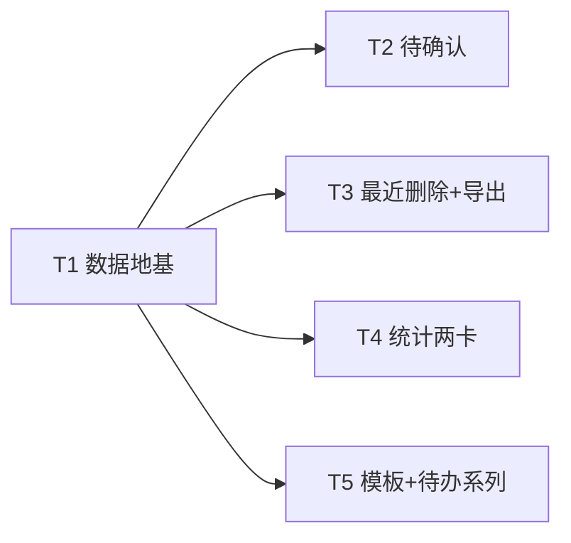

# 一账 V1.1 增量架构设计与任务分解

> 输入：`03-PRD-V1.1-增量.md`（5 项）+ `02-ARCHITECTURE.md`（A1–A4、§3/§4/§5.3/§5.4）。只做设计与分解，不含代码改动。前提：iOS 17.0+、SwiftUI + SwiftData、零第三方依赖、CloudKit 形状、无 `#Index`、既有 484 个测试方法全绿且**不得修改既有断言**。

## 1. 结论先行（7 个技术决策）

| # | 决策 | 结论 | 关键理由 |
| --- | --- | --- | --- |
| D1 | SchemaV2 落地 | **新建 `SchemaV2`（7 模型 / 2.0.0），`SchemaV1` 原样保留 6 模型；`schemas = [V1, V2]`、`stages` 保持 `[]`（隐式轻量迁移）；`ModelContainerFactory` 换 `SchemaV2` 并补 `migrationPlan:`。不做 V1 模型快照复制** | 本次变更 = 加带默认值的标量 + 1 个新实体 + 2 个可选 to-many，100% 在轻量迁移范围内。快照复制要给 6 个 `@Model` 各造 `xxxV1` 副本并让 80 个源文件改指向，两套同名类型无法共存于同一 module——成本远超收益。`stages` 留空是为让 `ModelContainerTests` 的 `XCTAssertTrue(stages.isEmpty)` 继续成立 |
| D2 | 最近删除谓词 | **加 `LedgerEntry.deletedDay: Int32 = 0` 哨兵**（`0` = 未删除，删除时写 `yyyyMMdd`）；`deletedAt` 保留做精确时间与排序 | 全项目现有 `#Predicate` **0 处**使用 `Optional<Date>` 非等值比较（只有 `== nil`），`QueryDescriptors` 顶部已记录 iOS 17 该崩溃面。整数区间一次解决 30 天窗口、按删除日分组、500 条淘汰，不碰 `Calendar`，与 A2 一致 |
| D3 | `confirmRaw` 默认值与唯一写入点 | `var confirmRaw: String = "confirmed"`；**唯一写入点 = `LedgerService.validated(_:)` 新增第 ⑥ 步**，`EntryDraft.confirmRaw: String? = nil`（`nil` 才自动判定） | `validated` 是 manual/todo/subscription **所有**写入的必经之地，且同时持有 `source`、`occurredDay`、`todayProvider`——规则只能写一次。`SweepAction.draft`（Domain）拿不到「今天」；`LedgerWriter.insert` 受 A3 约束不得含业务规则 |
| D4 | `EntryTemplate` 反向关系 | **加** `Category.templates` / `Account.templates`，均 `@Relationship(.nullify, inverse:)` | CloudKit 要求每个 to-many 有显式 `inverse:`。既有查询全是标量谓词（`QueryDescriptors` 无一条基于关系数组），`AccountBalanceCalculator` 只用 `entries`/`incomingTransfers` → **对既有查询与测试零影响**。风险仅为漏写 `inverse:` 或两侧 deleteRule 不一致（启动即崩） |
| D5 | 「待确认」筛选影响面 | 新增**第七维 `pendingOnly: Bool`**（非三态）；`EntryFilterTarget` 加 `isPending`；**`QueryDescriptors` 零改动** | 筛选是 `LedgerHomeViewModel.applyFilterToGroups()` 的内存筛选，走 `filter.matches`，**不入谓词**——本次最关键的省工结论。chip id 沿用风格 `"pending"` |
| D6 | 导出兼容 | `ExportRow.isPending: Bool = false`；CSV **新增** `csvHeaderColumnsWithConfirmation`（11 列）+ `csv(...includesConfirmationColumn: Bool = false)`，**默认 false，`ExportView` 传 true**；JSON 每 entry **无条件**加 `"confirmation"` | `Acceptance_ExportTests:82` 断言 `header == csvHeaderColumns`，该常量是契约不能改 → 新列必须 opt-in。JSON 侧既有断言全是字典逐键取值（`entry["amountCents"]`、`payload["entries"]` 计数），无键集合断言 → 加键安全 |
| D7 | 待办「删除此次及以后」撤销 | **现有代码没有任何待办撤销机制**（`TodoService.delete(id:)` = `writer.delete` 硬删；`reopen` 只撤销完成）。方案：Service 返回纯值类型 `TodoDeletionReceipt`，`TodoListViewModel` 持 3 秒内存快照 | `NotificationService` 只有全量 `rescheduleAll`/`replacePending`，无单条取消 API → 撤销后必须 `env.rescheduleNotifications()`。快照不落库、不给 `Todo` 加 `deletedAt`（PRD §4.3-3） |

**为什么不需要 seriesID**：下一期只在 `complete` 时生成（`TodoService.swift:427` 是唯一调用点），任一时刻一个系列最多 1 条未完成行。删掉它 = 它永不被完成 = 永不再生成。故「删除此次及以后」= 硬删 + **不 spawn**；「删除这一期」= 硬删 + **立即 spawn**。
**跨层冲突结论**（`ExpenseComparison` 在 Features、`StatisticsCalculator` 在 Domain）：`PeriodComparison` / `AccountShare` 定义在 **`Core/Domain/PeriodComparison.swift`**，`percentText` 与 `.unavailable/.flat` 规则**复制 12 行**，**不迁移 `ExpenseComparison`**（被 `LedgerHomeViewModelTests` 直接引用，挪位置 = 改既有测试）。一致性由新增 `PeriodComparisonParityTests` 保证逐字相同。

## 2. 数据模型变更

| 模型 | 变更 | 声明 |
| --- | --- | --- |
| `LedgerEntry` | + `confirmRaw: String` | `= "confirmed"`，取值 `confirmed`/`pending`；加 `confirmation`、`isPending` |
| `LedgerEntry` | + `deletedDay: Int32` | `= 0`（`0` = 未删除），与 `deletedAt` 必须同进同出（R1） |
| `Category` / `Account` | + `templates: [EntryTemplate]?` | `= []`，`@Relationship(.nullify, inverse: \EntryTemplate.category / .account)` |
| `EntryTemplate` | **新实体（第 7 个模型）** | `id/name/typeRaw/amount/hasAmount/note/sortOrder/createdAt/updatedAt` + `category?`/`account?`；不存日期、来源、转账 |

全部满足 CloudKit 形状：字面量默认值、零 `.unique`/`.deny`/`.cascade`、无可选标量（金额用 `hasAmount`）、每个 to-many 有显式 `inverse:`。

**SchemaV2 引用点（全项目仅 3 处，已 grep 确认）**

| 文件 | 动作 |
| --- | --- |
| `Core/Persistence/SchemaV1.swift` | 追加 `enum SchemaV2`（7 模型 / 2.0.0）；`schemas = [SchemaV1.self, SchemaV2.self]`，`stages` 不动 |
| `Core/Persistence/ModelContainerFactory.swift:33` | `SchemaV1.self` → `SchemaV2.self`；`ModelContainer(for:configurations:)` → `ModelContainer(for:migrationPlan: YiZhangMigrationPlan.self, configurations:)`。**⚠️ 该文件注释称「V2 容器创建代码零改动」，与事实不符——必须改，见 R4** |
| `Core/Persistence/Diagnostics.swift:224` | **不动**（`SchemaV1.models.count` 保持 6）。改它会撞 `ModelContainerTests:249` 的 `XCTAssertEqual(report.modelCount, 6)`；代价是自检日志停在「6 个模型」，记 R8 债务 |

**真实数据升级路径**：覆盖安装 → SwiftData 读 store 元数据版本（V1）→ 在 `schemas` 找到 V2 → 无显式 stage → 隐式轻量迁移 → 原地 `ALTER TABLE` 补 `ZCONFIRMRAW`/`ZDELETEDDAY`（带默认值）+ 建 `ZENTRYTEMPLATE` 表。不重建、不需备份。验收见 T1。

## 3. 文件清单（新建 = **粗体**）

| 任务 | 文件 |
| --- | --- |
| T1 | `Core/Persistence/SchemaV1.swift`、`ModelContainerFactory.swift`、`Core/Models/LedgerEntry.swift`、`LedgerEntry+Draft.swift`、`Category.swift`、`Account.swift`、`Core/Domain/LedgerLite.swift`、`Enums.swift`、`Core/Persistence/LedgerWriter.swift`、`App/AppEnvironment.swift`；**`Core/Models/EntryTemplate.swift`、`Core/Services/TemplateService.swift`、`Core/Services/TrashService.swift`** |
| T2 | `Core/Services/LedgerService.swift`、`SubscriptionService.swift`、`Core/Domain/EntryFilter.swift`、`Core/Models/LedgerEntry+Filter.swift`、`Features/Ledger/EntryFilterSheet.swift`、`LedgerHomeViewModel.swift`、`EntryRowView.swift`、`EntryDetailView.swift`、`HomeHeaderCards.swift`、`LedgerHomeView.swift`；**`Features/Ledger/PendingReviewView.swift`** |
| T3 | `Features/Settings/SettingsView.swift`、`Core/Services/ExportService.swift`、`Features/Settings/ExportView.swift`；**`Features/Settings/TrashView.swift`、`TrashViewModel.swift`** |
| T4 | `Features/Statistics/StatisticsViewModel.swift`、`StatisticsView.swift`；**`Core/Domain/PeriodComparison.swift`、`Features/Statistics/ComparisonCards.swift`** |
| T5 | `Features/Entry/EntryViewModel.swift`、`EntrySheetView.swift`、`Core/Services/TodoService.swift`、`Features/Todo/TodoListViewModel.swift`、`TodoRowView.swift`、`TodoListView.swift`；**`Features/Entry/TemplateChipsRow.swift`、`SaveAsTemplateSheet.swift`、`Features/Settings/TemplateManageView.swift`、`TemplateManageViewModel.swift`** |

## 4. 关键接口与数据结构

```swift
// Enums.swift（T1）
enum EntryConfirmation: String, CaseIterable { case confirmed, pending }
// LedgerEntry: var confirmation: EntryConfirmation { EntryConfirmation(raw: confirmRaw) ?? .confirmed }
//             var isPending: Bool { confirmRaw == EntryConfirmation.pending.raw }

// TrashService.swift（T1：只读查询 + 三种销毁）
struct TrashItem: Identifiable, Sendable {
    let id: UUID; let occurredDay: Int32; let amount: Money; let note: String
    let categoryID: UUID?; let accountID: UUID?; let sourceRaw: String
    let confirmRaw: String; let deletedDay: Int32; let deletedAt: Date; let remainingDays: Int
}
struct TrashDayGroup: Identifiable, Sendable { let day: Int32; let items: [TrashItem]; var id: Int32 { day } }
final class TrashService {
    static let retentionDays = 30, capacity = 500
    func count() throws -> Int
    func groups(today: DateOnly) throws -> [TrashDayGroup]        // deletedDay 倒序 → deletedAt 倒序二次排序
    func restore(_ entryID: UUID, at moment: Date) throws          // unmarkDeleted + 订阅来源则 unsuppress(cycleKey:)
    func purge(_ entryID: UUID) throws                            // writer.hardDelete（已存在）
    func purgeAll() throws
    @discardableResult func purgeExpired(today: DateOnly) throws -> Int
}

// TemplateService.swift（T1）
struct TemplateDraft: Sendable { var name = ""; var typeRaw = "expense"; var amount: Int64 = 0
    var hasAmount = false; var note = ""; var categoryID: UUID?; var accountID: UUID? }
enum TemplateError: LocalizedError { case limitReached, nameEmpty, nameTooLong }
final class TemplateService {
    static let limit = 20
    func all() throws -> [EntryTemplate]                          // sortOrder ↑ → createdAt ↑ → id
    @discardableResult func create(_ draft: TemplateDraft) throws -> EntryTemplate
    func update(id: UUID, changing: TemplateDraft) throws
    func delete(id: UUID) throws
    func reorder(orderedIDs: [UUID]) throws
    @discardableResult func makeFrom(entryID: UUID, name: String) throws -> EntryTemplate
}

// LedgerService 增量（T2）
func confirm(id: UUID) throws -> Bool            // pending → confirmed；非 pending 返回 false（幂等）
func deny(id: UUID) throws -> UndoToken?         // 软删 + subscription.suppress(cycleKey:)；无订阅则纯软删
func pendingSummary() throws -> (count: Int, amount: Money)
@discardableResult func confirmAll() throws -> Int

// EntryFilter 增量（T2）
var pendingOnly: Bool = false    // isActive / activeDimensionCount / chips / removeChip / clearAll 各加一行
protocol EntryFilterTarget { /* 既有 7 项 */ var isPending: Bool { get } }

// PeriodComparison.swift（T4）
struct PeriodComparison: Hashable, Sendable {
    enum Direction { case increase, decrease, flat, unavailable }
    let current: Money; let baseline: Money
    let direction: Direction; let magnitudeThousandths: Int64
    static let unavailable: PeriodComparison
    var text: String                                         // 与 ExpenseComparison.text 同句式
    static func percentText(_ thousandths: Int64) -> String   // 逐字复制 Features 版规则
    static func make(current: Money, baseline: Money) -> PeriodComparison
}
struct AccountShare: Identifiable, Hashable, Sendable {       // 与 CategoryShare 同构（amount 为 Money）
    let accountID: UUID?; let amount: Money; let ratio: Double; let isMerged: Bool
    var id: String { accountID?.uuidString ?? (isMerged ? "merged.other" : "unassigned") }
    var percent: Int { Int((ratio * 100).rounded()) }
}
extension StatisticsCalculator {
    static func comparison(_ entries: [LedgerLite], metric: StatisticsMetric,
                           today: DateOnly) -> (yoy: PeriodComparison, mom: PeriodComparison)
    static func accountShares(_ entries: [LedgerLite], metric: StatisticsMetric,
                              range: StatisticsRange, today: DateOnly,
                              limit: Int = 6) -> (shares: [AccountShare], mergedIDs: Set<UUID>)
}

// TodoService 增量（T5）
struct TodoSnapshot: Sendable { /* 除关系外全部标量 + categoryID/accountID */ }
struct TodoDeletionReceipt: Sendable { let snapshot: TodoSnapshot; let spawnedNextID: UUID? }
func deleteAndStopSeries(id: UUID) throws -> TodoDeletionReceipt                        // 硬删 + 不 spawn
func deleteCurrentOccurrence(id: UUID, at moment: Date) throws -> TodoDeletionReceipt    // 硬删 + spawn
func undoDeletion(_ receipt: TodoDeletionReceipt) throws                                 // 重建 + 删掉 spawnedNextID
```

**明确不改**：`StatisticsSnapshot`（被 32 个既有测试当值对象比对，新数据单独放 VM）、`Todo` 模型（不加软删字段）、`QueryDescriptors`、`ExpenseComparison`。

## 5. 关键流程

1. **扫描 → pending 定型**：`SweepCoordinator` → `SweepAction.draft`（`confirmRaw == nil`）→ `writer.insert(draft)` → `validated` 第 ⑥ 步（`source == .subscription && occurredDay >= todayProvider().adding(days: -7).key` → `"pending"`，否则 `"confirmed"`）→ `makeEntry()` 落到 `LedgerEntry.confirmRaw`。
2. **确认 / 否定**：详情「这是对的」→ `ledger.confirm(id:)`（只改 `confirmRaw` + `updatedAt`，**金额不变**）；「不是这笔」→ `ledger.deny(id:)` → `writer.markDeleted`（同写 `deletedAt` + `deletedDay`）→ `subscription.suppress(cycleKey:of:)`；订阅已删则跳过抑制、不报错。批量 → `confirmAll()`。
3. **最近删除恢复**：`trash.restore(id)` → `writer.unmarkDeleted`（`deletedAt = nil`、`deletedDay = 0`）→ 订阅来源且 `sourceRefID`/`sourceCycleKey` 齐全则 `unsuppress(cycleKey:of:)` → `bumpDataVersion`。**幂等键仍被该账目占用，扫描不会补第二笔**（必断言）。
4. **待办删除两分支 + 撤销**：菜单（仅 `!isDone && repeatRule != .none` 显示三项）→ `deleteAndStopSeries` / `deleteCurrentOccurrence` → 硬删（+ 可选 spawn）→ `env.rescheduleNotifications()`（全量重算，取消该 todo 通知）→ VM 存 `TodoDeletionReceipt` + 3 秒 `Task.sleep` → 撤销 → `todo.undoDeletion` → 再 `rescheduleNotifications()`。
5. **模板填入**：`templates.all()` 为空则整行隐藏 → 点 chip → `EntryViewModel.applyTemplate(_:)`：填 `typeRaw`；`hasAmount == true` 覆盖金额、`false` **保留已输入金额**；分类/账户不存在或已归档则跳过该字段 + chip 下小字提示；**日期恒为今天**。

## 6. 任务列表（工程师唯一施工依据）

> **T1 必须先合入**（其余四个都改它建的表/字段）。T2–T5 之间无依赖，可并行。

**T1｜数据与持久化地基（P0）** — 文件见 §3
1. `SchemaV1.swift` 追加 `SchemaV2`（7 模型），`schemas = [V1, V2]`，`stages` 保持 `[]`。
2. `ModelContainerFactory` 换 `SchemaV2` + 补 `migrationPlan: YiZhangMigrationPlan.self`，并改掉过时注释。
3. `LedgerEntry` 加 `confirmRaw`/`deletedDay`/`confirmation`/`isPending`；`EntryTemplate` 新实体 + `Category.templates`/`Account.templates`（双向 `.nullify` + `inverse:`）。
4. `LedgerWriter` 新增 `markDeleted(_:at:)` / `unmarkDeleted(_:)` 两个**唯一**软删入口；`softDelete`/`restore` 改调它们；`Diagnostics` 修重复键时也走 `markDeleted`。
5. `LedgerLite` 加 `confirmRaw`；`EntryDraft` 加 `confirmRaw: String? = nil` 且 `makeEntry()` 带上；`LedgerEntrySnapshot` 加 `confirmRaw`/`deletedDay`，`init(entry:)` 与 `apply(to:)` 同步。
6. `TemplateService` + `TrashService` 完整实现，`AppEnvironment.init` 注册（共用 `writer`）并接 `onDidCommit`。

**T2｜订阅账目「待确认」（F-SUB-13）（P0，依赖 T1）**
1. `validated` 第 ⑥ 步定型；`confirm`/`deny`/`pendingSummary`/`confirmAll`。
2. `EntryFilterTarget` 加 `isPending`（两个 conformer 实现）；`EntryFilter` 加 `pendingOnly`（含 `chips`/`removeChip`/`clearAll`/`activeDimensionCount`）；`EntryFilterSheet` 加 `pendingSection`（复刻 `typeSection`）。
3. `EntryRowModel` 加 `isPending`（**显式测试 init 必须给默认值 `false`**），`makeRow` 传值；`EntryRowView` 金额右侧琥珀徽标；`EntryDetailView` 徽标 + 两个操作按钮。
4. `GlanceModel` 加 `pendingCount`/`pendingAmount`；`HomeHeaderCards` 概览卡拆第三行「含待确认 3 笔 ¥68.00 ›」，点击跳账本并套 `pendingOnly`。
5. `LedgerHomeView` 顶部行动条 + `PendingReviewView`（底部**只有**「全部确认」）；「×」用 `@AppStorage("ledger.pendingBarDismissedDay")` 记当天，**不进 schema**。

**T3｜最近删除 + 导出口径（P0，依赖 T1）**
1. `TrashViewModel`：`groups`/`count`/`restore`/`purge`/`purgeAll`；`purgeExpired` 挂冷启动 + 每次软删后。
2. `TrashView`：30 天分组、`剩余 N 天`、空态、二次确认；`SettingsView` 在「统计与数据」区加 `最近删除 N`。
3. `ExportService`：`ExportRow.isPending`、`csvHeaderColumnsWithConfirmation`、`includesConfirmationColumn` 参数、JSON 加 `"confirmation"`；`ExportView` 传 `true`。

**T4｜统计同比环比 + 账户构成（F-ACC-16）（P1，依赖 T1）**
1. `PeriodComparison.swift`：两个类型 + 两个 `extension StatisticsCalculator` 纯函数；同期对齐，去年同月天数不足取月末；`type == .transfer` 跳过、`isCountable == false` 跳过、只用 `Int32` 键。
2. `StatisticsViewModel` 新增 `comparison`/`accountShares`/`mergedAccountIDs`，`reload()` 里与 `snapshot` 并行算；**不动 `StatisticsSnapshot`**。
3. `ComparisonCards` 追加在三张卡之下；账户点按 → 复用筛选通道下钻（`accountIDs` + 当前 `range`）。
4. `accountID == nil` 并入「未知账户」哨兵，保证 `Σ accountShares.amount == snapshot.categoryTotal`。

**T5｜常用模板（F-ACC-14）+ 待办系列删除（F-TODO-11）（P1，依赖 T1）**
1. `EntryViewModel` 加 `templates: [TemplateOption]`（`load()` 取）与 `applyTemplate(_:)`；`EntrySheetView` 接入 `TemplateChipsRow`。
2. `SaveAsTemplateSheet`（详情「⋯」→ 存为模板，默认名 = 备注 → 分类名）+ `TemplateManageView`（拖拽/左滑删/点编辑/＋新建、满 20 置灰）。
3. `TodoService` 三个新方法 + `TodoSnapshot`/`TodoDeletionReceipt`；`TodoRowView.menu` 条件三项。
4. `TodoListViewModel` 持 3 秒快照（`Task.sleep` + 过期时间双保险）；`TodoListView` 确认弹层（两套文案）+ Toast「已停止重复 · 撤销」。



## 7. 共享知识

- **软删只有一个写法** `writer.markDeleted(entry, at:)`；**恢复只有一个写法** `writer.unmarkDeleted(entry)`。直接写 `entry.deletedAt = ...` 是 review reject 项（会漏 `deletedDay`）。
- 写账目只经 `LedgerService`；`LedgerWriter` 不得出现业务判定；读取只用 `env.readContext`。
- Domain 禁止 `import SwiftData` / `import SwiftUI`；`PeriodComparison`、`AccountShare`、`TodoSnapshot` 都是纯值类型。
- 金额只用 `Money`/`Int64` 分，展示走 `MoneyText`；自然日只用 `DateOnly`/`Int32 yyyyMMdd`，除 `DateOnly` 内 4 处外禁止出现 `Calendar`。
- 新 `#Predicate` 一律整数或 `String` 等值比较；**禁止 `Optional<Date>` 非等值比较**（`!= nil`/`>`/`<`）。
- 新 to-many 必须显式 `inverse:`，两侧 `.nullify`；禁止 `.unique`/`.deny`/`.cascade`；新标量必须有字面量默认值（`Date` 用 `Date(timeIntervalSince1970: 0)`）。
- 新服务的写入口统一接 `onDidCommit = { [weak self] in self?.bumpDataVersion() }`。
- 构建带 `OTHER_SWIFT_FLAGS=-disable-sandbox`；**不允许修改既有测试断言**，只能新增测试文件/方法。

## 8. 风险清单

| # | 风险 | 触发条件 | 对策 |
| --- | --- | --- | --- |
| **R1** | **最容易做错①**：`deletedDay` 与 `deletedAt` 脱节 | 绕过 `markDeleted` 直接写 `deletedAt`，或 `LedgerEntrySnapshot.apply` 漏带 `deletedDay` | T1 收敛为两个唯一入口；验收含 `grep -rn "deletedAt = " YiZhang/` 只命中 `LedgerWriter`；新增断言「恢复后 `deletedDay == 0`」 |
| **R2** | **最容易做错②**：`EntryRowModel` 新字段让 30+ 既有测试**编译失败** | 显式全参 init 的 `isPending` 没给默认值 → `LedgerHomeViewModelTests`/`EntryFilterTests`/`TodoListViewModelTests` 构造点全红 | `isPending: Bool = false` 必须带默认值；先改 init 再加使用点，改完立刻跑全量测试 |
| **R3** | **最容易做错③**：CSV 表头是契约 | 直接改 `csvHeaderColumns` 或让新列默认开启 → `Acceptance_ExportTests:82` 与 `ExportServiceTests` 表头/整行断言全红 | 新列 opt-in（默认 `false`），仅 `ExportView` 传 `true`；JSON 加键前已确认既有断言只做逐键取值 |
| R4 | `SchemaV1` 不是真正的历史快照 | 6 个 `@Model` 被就地改过；`stages = []` 依赖 SwiftData 隐式轻量迁移 | V1.0 未发版、零真实用户数据，接受；T1 内一并修掉 `ModelContainerFactory` 的过时注释；新增 `MigrationSmokeTests` 验证「旧库 → 新库」 |
| R5 | 轻量迁移在设备上失败 → 容器打不开 | 任何非增量改动（改类型、删字段、给标量加非默认约束） | 本次禁止其他 schema 改动；`AppEnvironmentError.containerUnavailable` 已有文案；发版前真机覆盖安装一次 |
| R6 | `percentText` 复制后与 `ExpenseComparison` 漂移 | 后续只改一处 | `PeriodComparisonParityTests` 断言同一输入两者输出逐字相同（含 `≥9990` 封顶 `999%+` 分支） |
| R7 | pending 判定误用 `Date()` | 冷启动补漏的历史账目被判 pending | 统一走 `LedgerService.todayProvider()`；测试注入固定 `today` |
| R8 | `Diagnostics` 报告模型数停在 6 | 刻意保留 `SchemaV1.models.count` 以不撞 `ModelContainerTests:249` | 记为债务，V1.2 统一改两处断言后切 `SchemaV2` |
| R9 | 「删除这一期」spawn 与 3 秒撤销竞态 | 撤销时 spawn 出的下一期已被用户手改 | 撤销以 `spawnedNextID` 为准：存在则删、不存在则跳过；撤销后 `rescheduleNotifications()` 全量重算兜底 |

## 9. 待明确事项（未回复即按推荐执行）

| # | 问题 | 推荐默认值 |
| --- | --- | --- |
| Q1 | `SchemaV1.models` 是否保留 6 条（只为让两条既有断言继续成立）？ | **保留**。若允许改 `ModelContainerTests` 的 2 处数字，则统一改 7 并让 `Diagnostics` 用 `SchemaV2`，R8 归零 |
| Q2 | CSV「确认状态」列默认关闭是否接受？ | **接受**（`includesConfirmationColumn: Bool = false`，仅 `ExportView` 传 `true`）。若允许改 2 处表头断言则默认改 `true` |
| Q3 | 「待确认」筛选用 `Bool` 还是三态（含「只看已确认」）？ | **`Bool`**。PRD 只要求筛出待确认；三态会让 chip 文案与 `activeDimensionCount` 语义变复杂 |
| Q4 | 最近删除页点行是否复用 `EntryDetailView`？ | **复用**，加 `isReadOnly: Bool = false` 参数，操作区换成「恢复 / 彻底删除」 |
| Q5 | 模板 chip 长按编辑/删除用什么承载？ | **`contextMenu`**（与既有「⋯」菜单风格一致，零新组件） |
| Q6 | 待办删除确认弹层用 `.alert` 还是 `.confirmationDialog`？ | **`.confirmationDialog`**（destructive + 取消，与订阅删除一致） |
| Q7 | 4000 条账目性能验收何时跑？ | 新增 `PerformanceTests` 一个方法，不阻塞功能合入，仅记录数值 |
